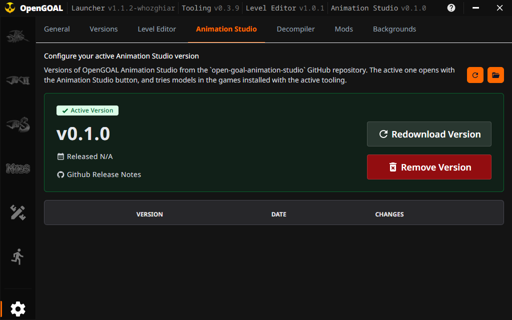
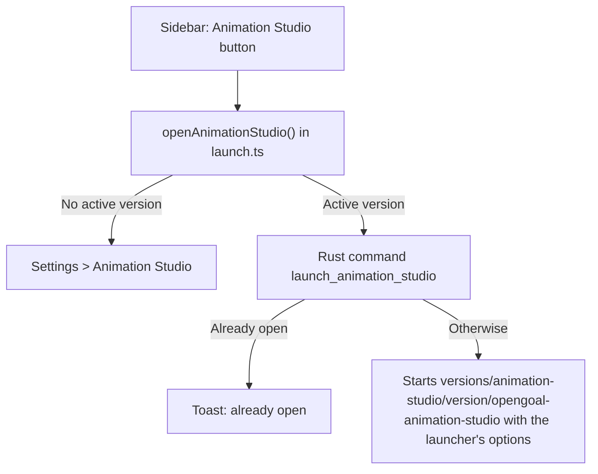

# Animation Studio

The **Animation Studio** button in the sidebar starts OpenGOAL Animation Studio, a program that plays, makes and checks the animations of the Jak games' characters. The launcher installs, updates and starts it the way it does Jak Level Editor, and the studio tries models in the games with the launcher's own OpenGOAL tools. This page explains what the launcher does for the studio, and what changed in the launcher to make that possible.

## Contents

- [1. What this feature brings](#1-what-this-feature-brings)
- [2. How the feature works](#2-how-the-feature-works)
- [3. How it integrates into the architecture](#3-how-it-integrates-into-the-architecture)
- [4. New files created](#4-new-files-created)
- [5. Overview of changes from the original project](#5-overview-of-changes-from-the-original-project)

## 1. What this feature brings

OpenGOAL Animation Studio is a separate project, [open-goal-animation-studio](https://github.com/whozghiar/open-goal-animation-studio), written in Rust and Svelte like the launcher. It works on the `.glb` models of the games' entities (Babak, Haven Citizen, Jak...). With it you can:

- play every animation of a model, and check it against what OpenGOAL's `build-actor` accepts;
- make a new animation from a video or a motion capture file, or key it by hand;
- export the model for a jak-project (the OpenGOAL source code);
- try the model in the game itself: it stands in front of Jak in the game's test level, playing the animation you pick.

What the launcher adds:

- **Updates without a launcher release.** Each studio version is downloaded from the studio's GitHub releases, as soon as it is published.
- **Its version in the header**, next to the Level Editor's, with a download icon when a newer one is out.
- **Versions you control** in **Settings > Animation Studio**: download one, make it active, go back to an older one, or delete it.
- **The launcher's tooling for the try in the game.** The studio tries models in the games installed with the launcher's active tooling, with that tooling's `gk` and `goalc`, and in no other game.

## 2. How the feature works

### Installing the studio

1. Click **Animation Studio** (running figure icon) in the sidebar, under the Level Editor's button.

   

2. No version is installed yet, so the launcher opens **Settings > Animation Studio**, the list of the studio's releases.
3. Click **Download** on the latest version. The launcher downloads the studio's portable build for your system, checks it, unpacks it and makes it the active version. The header then shows it after **Animation Studio**.

   

4. Click **Animation Studio** again. The studio opens in its own window. Clicking the button while it is open shows "The Animation Studio is already open" instead of starting a second one.

### Updating the studio

When the launcher starts, it compares the studio's latest release with the active version. If the latest one is newer and not downloaded yet, a pulsing download icon appears next to **Animation Studio** in the header. Click it to open **Settings > Animation Studio**, then download the new version: it becomes the active one. Nothing installs without a click, and older versions stay on disk until you delete them.

### What the launcher gives the studio

The launcher starts the studio with these options:

| What            | Option                                                                          | Effect in the studio                                                                                                      |
| :-------------- | :------------------------------------------------------------------------------ | :------------------------------------------------------------------------------------------------------------------------ |
| Language        | `--lang fr`, from the launcher's language                                       | The studio's texts in that language, when it has it (English, French).                                                    |
| Creations       | `--default-library=<install>/animation-studio`                                  | The folder where the studio keeps the models you change, when you have not chosen one yet.                                |
| Games           | `--game-install=jak3=<install>`, one per game installed with the active tooling | **Try in the game** uses that game, with the active tooling's `gk` and `goalc` (`<install>/active/bin`).                  |
| Tooling version | `--tooling-version=v0.3.9`, the active tooling (empty when there is none)       | The launcher started the studio: a game not installed with that tooling is not tried, rather than tried with other tools. |

For example, with the launcher installed in `D:\OpenGOAL`, the tooling `v0.3.9` active, Jak 3 installed with `v0.3.9` and Jak II with `v0.3.9-whozghiar.1`, the launcher runs:

```text
D:\OpenGOAL\versions\animation-studio\v0.1.0\opengoal-animation-studio.exe --lang en
  "--default-library=D:\OpenGOAL\animation-studio" "--game-install=jak3=D:\OpenGOAL"
  --tooling-version=v0.3.9
```

Then, in the studio:

| You try                                 | What happens                                                                                                                                                                    |
| :-------------------------------------- | :------------------------------------------------------------------------------------------------------------------------------------------------------------------------------ |
| Haven Citizen, in Jak 3                 | The game opens in its test level with the citizen next to Jak, about 30 s later. `D:\OpenGOAL\active\bin\goalc.exe` built it and `D:\OpenGOAL\active\bin\gk.exe` plays it.      |
| Jak II's escort kid (`kid-escort-lod0`) | The studio says "This game is not installed with the OpenGOAL Launcher's active tooling (v0.3.9): install or update it in the Launcher." Jak II was built with another tooling. |

The try replaces two files of the game while it runs (`out/jak3/iso/TSZ.DGO` and `out/jak3/fr3/test-zone.fr3` in `active/jak3/data`) and puts the game's own back when you close it. The studio's README explains the try step by step.

The studio keeps its settings in its own folder (`%APPDATA%/OpenGOAL/animation-studio` on Windows), whether the launcher started it or not. Its output goes to `animation-studio.log`, in the launcher's log folder.

## 3. How it integrates into the architecture

### Files on disk

| Location                                         | Content                                                                                                              |
| :----------------------------------------------- | :------------------------------------------------------------------------------------------------------------------- |
| `<install>/versions/animation-studio/<version>/` | One downloaded version: `opengoal-animation-studio(.exe)` and its MCP server, `opengoal-animation-studio-mcp(.exe)`. |
| `settings.json`, field `animationStudioVersion`  | The active version.                                                                                                  |
| `<install>/animation-studio/`                    | The default creations folder.                                                                                        |
| `<install>/active/bin/`                          | The active tooling's `gk`, `goalc` and `extractor`, which the try in the game runs.                                  |

### From the button to the studio



[launch.ts](../../src/lib/animation-studio/launch.ts) holds the button's logic. Unlike the Level Editor, the studio has builds for Windows, Linux and macOS, so the button, the header and the settings show it on every system.

### Versions and updates

The studio reuses the code of the tooling and the Level Editor:

- [github.ts](../../src/lib/utils/github.ts): `ANIMATION_STUDIO_REPOSITORY` is `whozghiar/open-goal-animation-studio`. `listAnimationStudioReleases` and `getLatestAnimationStudioRelease` pick the asset `opengoal-animation-studio-portable-<platform>.zip`, where `<platform>` is `windows-x64`, `linux-x64` or `macos-universal` (one build for both kinds of Mac).
- [Header.svelte](../../src/components/header/Header.svelte): `checkForProgramUpdate` checks the Level Editor and the studio, and the snippet `programVersion` shows each one's version and update icon.
- [Versions.svelte](../../src/routes/settings/Versions.svelte): `kind="animationStudio"` picks the studio's commands, folder and texts.

The Rust commands, in [animation_studio.rs](../../src-tauri/src/commands/features/animation_studio.rs):

| Command                             | What it does                                                                                                          |
| :---------------------------------- | :-------------------------------------------------------------------------------------------------------------------- |
| `list_downloaded_versions`          | The tooling's command, with the folder `animation-studio`: lists the versions on disk.                                |
| `download_animation_studio_version` | Downloads the release's portable build, checks it against GitHub's SHA-256 of it, unpacks it into its version folder. |
| `remove_animation_studio_version`   | Deletes a version folder, and clears the active version if it was that one.                                           |
| `set_animation_studio_version`      | Saves the active version in `settings.json`.                                                                          |
| `launch_animation_studio`           | Starts the active version with the options above. Answers `false` when the studio it started before is still running. |

They share with the Level Editor's commands, in [level_editor.rs](../../src-tauri/src/commands/features/level_editor.rs), the unpacking of a release (`unpack`), the games installed with the active tooling (`games_to_try`) and the options both programs take (`launch_args`).

### Publishing a new studio version

Run the release workflow of [open-goal-animation-studio](https://github.com/whozghiar/open-goal-animation-studio). Once its release is published, not left as a draft, with the `opengoal-animation-studio-portable-<platform>.zip` files, launchers offer it at their next start. Until the studio's first release, **Settings > Animation Studio** says "No releases could be retrieved from GitHub!".

## 4. New files created

| File                                                                                                               | Role                                                 |
| :----------------------------------------------------------------------------------------------------------------- | :--------------------------------------------------- |
| [`src/lib/animation-studio/launch.ts`](../../src/lib/animation-studio/launch.ts)                                   | Starts the studio, or opens its versions page.       |
| [`src-tauri/src/commands/features/animation_studio.rs`](../../src-tauri/src/commands/features/animation_studio.rs) | Downloads, removes and starts the studio's versions. |
| [`docs/features_ai/features_animation_studio.md`](features_animation_studio.md)                                    | This document.                                       |
| [`docs/img/animation_studio/`](../img/animation_studio/)                                                           | The screenshots of the sidebar and of the settings.  |

## 5. Overview of changes from the original project

- **Sidebar**: [Sidebar.svelte](../../src/components/sidebar/Sidebar.svelte) gains the **Animation Studio** button.
- **Header**: [Header.svelte](../../src/components/header/Header.svelte) shows the studio's version and its update icon. The Level Editor's version and the studio's share the snippet `programVersion` and the function `checkForProgramUpdate`. The spaces between the versions are a little narrower, so that the four fit in the window's default width (1024 px); in a narrower window, the help and window buttons cover the end of the line instead of drawing over it.
- **Settings**: [Settings.svelte](../../src/routes/Settings.svelte) gains the **Animation Studio** tab, served by the Versions page.
- **Releases**: [github.ts](../../src/lib/utils/github.ts) reads the studio from its own repository; [github.test.ts](../../src/lib/utils/github.test.ts) checks the asset picked on each system.
- **Settings file**: [config.rs](../../src-tauri/src/config.rs) adds `animationStudioVersion`. The TypeScript type [LauncherConfig.ts](../../src/lib/rpc/bindings/LauncherConfig.ts) is regenerated by `ts-rs`.
- **Backend**: [main.rs](../../src-tauri/src/main.rs) registers the studio's commands. [level_editor.rs](../../src-tauri/src/commands/features/level_editor.rs) shares `unpack`, `games_to_try` and `launch_args` (formerly `editor_args`, which now takes the default library) with the studio.
- **Translations**: the studio's texts (`sidebar_animationStudio`, `header_animationStudioVersionLabel`, `settings_tabs_animationStudio`, `settings_versions_animationStudio_*`, `toasts_savedAnimationStudioVersion`, `toasts_animationStudioAlreadyOpen`) were added to [en-US.json](../../src/assets/translations/en-US.json).
