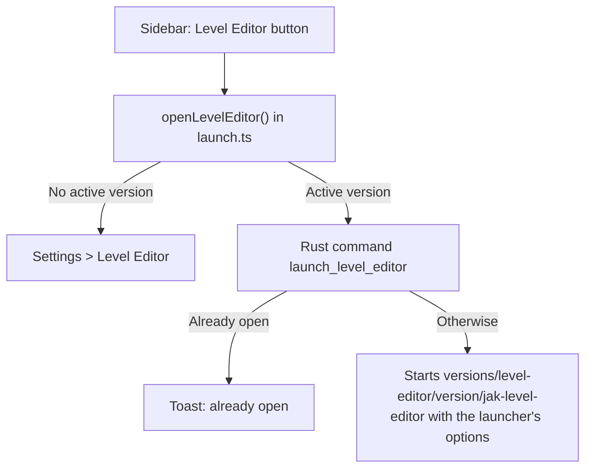

# Level Editor

The **Level Editor** button in the sidebar starts Jak Level Editor, a level editor for the Jak games. The launcher installs and updates the editor the way it does the OpenGOAL tools: each version is downloaded from a GitHub release, and you choose which one is active. This page explains what the editor offers, how the launcher installs, updates and starts it, and what changed in the launcher to make that possible.

## Contents

- [1. What this feature brings](#1-what-this-feature-brings)
- [2. How the feature works](#2-how-the-feature-works)
- [3. How it integrates into the architecture](#3-how-it-integrates-into-the-architecture)
- [4. New files created](#4-new-files-created)
- [5. Overview of changes from the original project](#5-overview-of-changes-from-the-original-project)

## 1. What this feature brings

Jak Level Editor is a separate project, [jak-level-editor](https://github.com/whozghiar/jak-level-editor), written in Rust and Svelte like the launcher. With it you can:

- open any level of the game, read from your own disc;
- move, copy and delete its pieces, and place objects, prefabs and whole buildings;
- paint terrain;
- see the level lit as the game lights it, at any hour of the day;
- generate the paths that creatures walk on;
- export the result as a custom level that OpenGOAL builds and plays.

The editor works on Jak 3 today. Its **Game** menu also lists Jak and Daxter and Jak II, marked _Work in progress_. It does not play levels: it exports them as files to copy into a jak-project (the OpenGOAL source code), with a README and the guide's tutorial _Add your level to the game by hand_.

What the launcher adds:

- **Updates without a launcher release.** The editor is a program of its own, downloaded from the editor's releases. A new editor version reaches users as soon as it is published.
- **An alert when a version is out.** A download icon appears next to the editor's version in the header, as it does for the launcher and the tooling.
- **Versions you control.** **Settings > Level Editor** lists the versions: download one, make it active, go back to an older one, or delete it.
- **What the launcher already knows.** The editor gets the launcher's language, keeps its preferences in the launcher's folder, and starts its extraction from the discs the launcher already extracted.
- **OpenGOAL from a fork.** The launcher installs and updates OpenGOAL from the releases of [whozghiar/jak-project](https://github.com/whozghiar/jak-project) instead of the upstream project. These releases carry fixes to the level builder that the editor's levels need.

> [!NOTE]
> The Level Editor is not offered on macOS for now: the fork's tools and the editor have no macOS build.

## 2. How the feature works

### Installing the editor

1. Click **Level Editor** (pencil-and-ruler icon) in the sidebar, above Settings.

   

2. No version is installed yet, so the launcher opens **Settings > Level Editor**, the list of the editor's releases.
3. Click **Download** on the latest version. The launcher downloads the editor's portable build for your system (about 10 MB, with its extractor and translations), checks it, unpacks it and makes it the active version.
4. Click **Level Editor** again. The editor opens in its own window.

### Updating the editor

When the launcher starts, it compares the editor's latest release with the active version. If the latest one is newer and not downloaded yet, a pulsing download icon appears next to **Level Editor** in the header. Click it to open **Settings > Level Editor**, then download the new version: it becomes the active one.

Nothing is installed without a click. The launcher handles its three components the same way:

| Component    | Where the alert shows                   | What installs the update                                                  |
| :----------- | :-------------------------------------- | :------------------------------------------------------------------------ |
| Launcher     | Icon next to the launcher's version     | The update page: one click downloads, installs and restarts the launcher. |
| Tooling      | Icon next to the tooling's version      | **Settings > Versions**: download the version, it becomes active.         |
| Level Editor | Icon next to the Level Editor's version | **Settings > Level Editor**: download the version, it becomes active.     |

All three checks run once, when the launcher starts. Older versions stay on disk until you delete them, so you can make one active again from the list.

### What the launcher gives the editor

The launcher starts the editor with these settings:

| What            | How                                                                                      | Effect                                                                              |
| :-------------- | :--------------------------------------------------------------------------------------- | :---------------------------------------------------------------------------------- |
| Language        | `--lang fr`, from the launcher's language                                                | The editor's texts in that language, when the editor has it (English, French).      |
| Preferences     | The `JLE_PREFS_DIR` environment variable: `<launcher config>/jak-level-editor`           | The editor keeps its library and caches there, apart from the standalone editor's.  |
| Default library | `--default-library=<install>/jak-level-editor`                                           | The folder the first-run assistant offers for the library.                          |
| Discs           | `--extract-source=jak3=<install>/active/jak3/data/iso_data/jak3`, one per installed game | **File > Extract game assets** starts from the disc the launcher already extracted. |

`<launcher config>` is `%APPDATA%/OpenGOAL-Launcher` on Windows. It is the folder the editor's preferences were already in when earlier builds of this fork ran the editor inside the launcher, so the library chosen then is kept.

> [!IMPORTANT]
> `--default-library` and `--extract-source` need an editor version that knows them, newer than v1.0.0. Older versions skip them whole, because they are written as `--name=value`. With such a version, the first-run assistant offers `Documents/Jak Level Editor` and the extraction asks for the disc.

### One editor at a time

If you click **Level Editor** while the editor it started is still open, the launcher shows "The Level Editor is already open" instead of starting a second one on the same preferences.

The editor's output goes to `level-editor.log`, in the launcher's log folder.

## 3. How it integrates into the architecture

### Files on disk

| Location                                     | Content                                                                                |
| :------------------------------------------- | :------------------------------------------------------------------------------------- |
| `<install>/versions/level-editor/<version>/` | One downloaded version: `jak-level-editor(.exe)`, `ogle-extract`, `lang/` and `data/`. |
| `settings.json`, field `levelEditorVersion`  | The active version.                                                                    |
| `<launcher config>/jak-level-editor/`        | The editor's preferences and caches.                                                   |
| `<install>/jak-level-editor/`                | The default library: extracted levels, projects, exports.                              |

### From the button to the editor

[launch.ts](../../src/lib/level-editor/launch.ts) holds the button's logic and `LEVEL_EDITOR_AVAILABLE`, which hides the editor on macOS.

### Versions and updates

The editor reuses the tooling's version code, with its own repository and files:

- [github.ts](../../src/lib/utils/github.ts): `LEVEL_EDITOR_REPOSITORY` is `whozghiar/jak-level-editor`. `listLevelEditorReleases` and `getLatestLevelEditorRelease` share their code with the tooling's functions and pick the asset `jak-level-editor-portable-windows-x64.zip` or `jak-level-editor-portable-linux-x64.zip`.
- [Header.svelte](../../src/components/header/Header.svelte): `checkForLevelEditorUpdate`, next to `checkForToolingUpdate`, sets `selectedLevelEditor` in `UpdateStore` ([AppStore.ts](../../src/lib/stores/AppStore.ts)).
- [Versions.svelte](../../src/routes/settings/Versions.svelte): one page for both. `kind="levelEditor"` picks the editor's commands, folder and texts. [Latest.svelte](../../src/routes/settings/versions/Latest.svelte) and [VersionList.svelte](../../src/routes/settings/versions/VersionList.svelte) take the active version to show through `activeKey`, from [VersionState.svelte.ts](../../src/state/VersionState.svelte.ts).

The Rust commands, in [level_editor.rs](../../src-tauri/src/commands/features/level_editor.rs) except the first:

| Command                         | What it does                                                                                                                                                                                          |
| :------------------------------ | :---------------------------------------------------------------------------------------------------------------------------------------------------------------------------------------------------- |
| `list_downloaded_versions`      | The tooling's command, with the folder `level-editor`: lists the versions on disk.                                                                                                                    |
| `download_level_editor_version` | Downloads the release's portable build, checks it against GitHub's SHA-256 of it (`download_release_asset` in [network.rs](../../src-tauri/src/util/network.rs)), unpacks it into its version folder. |
| `remove_level_editor_version`   | Deletes a version folder, and clears the active version if it was that one.                                                                                                                           |
| `set_level_editor_version`      | Saves the active version in `settings.json`.                                                                                                                                                          |
| `launch_level_editor`           | Starts the active version with the options above. Answers `false` when the editor it started before is still running.                                                                                 |

### Publishing a new editor version

Run the release workflow of [jak-level-editor](https://github.com/whozghiar/jak-level-editor). Once its release is published, not left as a draft, with the `jak-level-editor-portable-<platform>.zip` files, launchers offer it at their next start. The launcher needs no release of its own.

### OpenGOAL releases from the fork

`TOOLING_REPOSITORY` in [github.ts](../../src/lib/utils/github.ts) is `whozghiar/jak-project`, so the Versions page, the header's update icon and the automatic update follow the fork's releases.

- The fork's workflow `release-tooling.yml` publishes them with a tag `vX.Y.Z` or `vX.Y.Z-suffix`. For example, `v0.3.9-whozghiar.1` is the fork's first build of upstream version 0.3.9. The archives are named like upstream's: `opengoal-windows-<tag>.zip` and `opengoal-linux-<tag>.tar.gz`.
- A repository with no release yet means no update, without an error.
- The Versions page keeps listing versions installed earlier that the fork does not publish, such as upstream's `v0.3.8`, so they can still be chosen again or removed.
- A suffix does not make a pre-release of X.Y.Z. `tooling_version` in [config.rs](../../src-tauri/src/config.rs) reads the version as X.Y.Z when the launcher checks minimum versions. Elsewhere, versions are only compared for equality and sorted by date.
- Tooling downloads are checked against GitHub's SHA-256 too ([versions.rs](../../src-tauri/src/commands/versions.rs)).

## 4. New files created

| File                                                                                                       | Role                                                 |
| :--------------------------------------------------------------------------------------------------------- | :--------------------------------------------------- |
| [`src/lib/level-editor/launch.ts`](../../src/lib/level-editor/launch.ts)                                   | Starts the editor, or opens its versions page.       |
| [`src-tauri/src/commands/features/level_editor.rs`](../../src-tauri/src/commands/features/level_editor.rs) | Downloads, removes and starts the editor's versions. |
| [`docs/features_ai/features_level_editor.md`](features_level_editor.md)                                    | This document.                                       |
| [`docs/img/level_editor/capture_1.png`](../img/level_editor/capture_1.png)                                 | The screenshot of the sidebar button.                |

## 5. Overview of changes from the original project

- **Sidebar**: [Sidebar.svelte](../../src/components/sidebar/Sidebar.svelte) gains the **Level Editor** button, except on macOS.
- **Header**: [Header.svelte](../../src/components/header/Header.svelte) shows the editor's version and its update icon.
- **Settings**: [Settings.svelte](../../src/routes/Settings.svelte) gains the **Level Editor** tab. The Versions page and its two components serve both the tooling and the editor.
- **Releases**: [github.ts](../../src/lib/utils/github.ts) reads the tooling from the fork and the editor from its own repository, with the same code.
- **Settings file**: [config.rs](../../src-tauri/src/config.rs) adds `levelEditorVersion`, and `tooling_version` so a fork's version meets the minimums of its X.Y.Z. The TypeScript type [LauncherConfig.ts](../../src/lib/rpc/bindings/LauncherConfig.ts) is regenerated by `ts-rs`.
- **Backend**: [main.rs](../../src-tauri/src/main.rs) registers the editor's commands. [network.rs](../../src-tauri/src/util/network.rs) adds `download_release_asset`, which checks a release asset against its SHA-256, used for the editor and the tooling.
- **Versions page**: [Versions.svelte](../../src/routes/settings/Versions.svelte) keeps listing installed versions the fork does not publish.
- **Translations**: the editor's texts (`sidebar_levelEditor`, `header_levelEditorVersionLabel`, `settings_tabs_levelEditor`, `settings_versions_levelEditor_*`, `toasts_savedLevelEditorVersion`, `toasts_levelEditorAlreadyOpen`) were added to [en-US.json](../../src/assets/translations/en-US.json).

Earlier builds of this fork compiled the editor into the launcher, as a submodule (`level-editor/`) and a Tauri plugin. Downloading it as a separate program lets it update without a launcher release, and the launcher builds without the editor's code.
