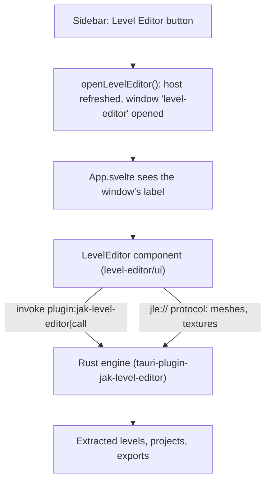

# Level Editor

The **Level Editor** button in the sidebar opens Jak Level Editor, a level editor for the Jak games, in a window of its own. This page explains what the editor offers, how the launcher hosts it, and what changed in the launcher to make that possible.

## Contents

- [1. What this feature brings](#1-what-this-feature-brings)
- [2. How the feature works](#2-how-the-feature-works)
- [3. How it integrates into the architecture](#3-how-it-integrates-into-the-architecture)
- [4. New files created](#4-new-files-created)
- [5. Overview of changes from the original project](#5-overview-of-changes-from-the-original-project)

## 1. What this feature brings

Jak Level Editor is a separate project, [jak-level-editor](https://github.com/whozghiar/jak-level-editor), written in Rust and Svelte like the launcher. The launcher plugs it in without keeping a copy of its code.

With the editor you can:

- open any level of the game, read from your own disc;
- move, copy and delete its pieces, and place objects, prefabs and whole buildings;
- paint terrain;
- see the level lit as the game lights it, at any hour of the day;
- generate the paths that creatures walk on;
- export the result as a custom level that OpenGOAL builds and plays.

An AI assistant can also drive the editor, through an MCP server.

The editor works on Jak 3 today. Its **Game** menu also lists Jak and Daxter and Jak II, marked _Work in progress_.

Three things are worth knowing:

- **The disc is not asked for again.** The editor reads the disc that the launcher already extracted when Jak 3 was installed. The editor's own extractor is downloaded the first time it is needed.
- **The editor does not play levels.** It exports them as files to copy into a jak-project (the OpenGOAL source code), with a README and the guide's tutorial _Add your level to the game by hand_.
- **OpenGOAL comes from a fork.** The launcher installs and updates OpenGOAL from the releases of [whozghiar/jak-project](https://github.com/whozghiar/jak-project) instead of the upstream project. These releases carry fixes to the level builder that the editor's levels need. Updates arrive as before: the update icon in the header, the Versions page and the automatic update.

> [!NOTE]
> The Level Editor is not offered on macOS for now: the fork's tools and `ogle-extract` have no macOS build.

## 2. How the feature works

### Opening the editor

1. Click **Level Editor** (pencil-and-ruler icon) in the sidebar, above Settings.

   

2. The launcher opens a second window, maximized. If the editor is already open, the launcher brings it to the front and restores it if it was minimized.

Closing the launcher's main window leaves the editor open. The editor asks before closing when work is not saved.

### What the window shows

Like the launcher's window, the editor's window has no system frame, so the editor draws its own title bar: the level's name, an orange dot when the level is not saved, and the minimize, maximize and close buttons. Below the title bar:

| Area      | Content                                                                                  |
| :-------- | :--------------------------------------------------------------------------------------- |
| Menus     | File, Edit, View, Build, Level, Help                                                     |
| Toolbar   | Move, rotate, scale, topology, terrain, copy, paste, delete, create a prefab, undo, redo |
| Left tabs | Levels, Build, Catalog, Prefabs, Groups                                                  |
| Center    | The 3D view                                                                              |
| Right     | The inspector of the selection                                                           |
| Bottom    | The status bar                                                                           |

The editor's texts follow the launcher's language when the editor has it (English or French).

### The first time: extracting the game's levels

The editor needs the game's levels before it can open one. **File > Extract game assets** reads Jak 3 with `ogle-extract`, the editor's extractor, built from OpenGOAL's decompiler. In the launcher:

| What           | Where                                                                                                                     |
| :------------- | :------------------------------------------------------------------------------------------------------------------------ |
| Source         | The disc the launcher extracted when Jak 3 was installed, `<install>/active/jak3/data/iso_data/jak3`.                     |
| Level library  | `<install>/jak-level-editor` by default.                                                                                  |
| `ogle-extract` | Downloaded the first time, from the release of the editor's version, into `<install>/jak-level-editor/tools/v<version>/`. |

The editor's preferences (its library, its caches) belong to the launcher, in `<launcher config folder>/jak-level-editor/`, which is `%APPDATA%/OpenGOAL-Launcher/jak-level-editor` on Windows. The standalone editor keeps its own preferences, so the two never share a library.

### Closing and reopening

The editor's engine runs as long as the launcher does. A saved level left open when you close the editor's window is shown again when you reopen it. Choosing **Don't save** when closing discards the document.

### Exporting a level

After a level is exported for the game, the export report offers the guide's tutorial _Add your level to the game by hand_. The exported files go into a jak-project, as their README explains.

## 3. How it integrates into the architecture

### The path of a click

1. The sidebar button calls `openLevelEditor()` in [window.ts](../../src/lib/level-editor/window.ts). It refreshes what the launcher gives the editor (see [What the launcher gives the editor](#what-the-launcher-gives-the-editor)), then opens or focuses the window labelled `level-editor`.
2. That window loads the launcher's own interface. [App.svelte](../../src/App.svelte) sees the window's label and shows the editor's `LevelEditor` component instead of the launcher's pages.
3. The editor talks to its engine, written in Rust and running inside the launcher's process, through a single Tauri command, `call`. It reads the 3D data of a level (meshes, textures) through its own `jle://` protocol.



### The submodule

The editor's repository is a git submodule in `level-editor/`. It is pinned to a tag of the editor: the launcher records one commit and follows no branch. Clone the launcher with `git clone --recursive`, or run `git submodule update --init` once after cloning.

To move to a new version of the editor:

```bash
git -C level-editor fetch --tags
git -C level-editor checkout vX.Y.Z
git add level-editor
git commit
```

### The editor's plugin

[src-tauri/Cargo.toml](../../src-tauri/Cargo.toml) depends on `level-editor/crates/tauri-plugin`. [main.rs](../../src-tauri/src/main.rs) registers the plugin with `Builder::new().prefs_in_app_config()`, which puts the editor's preferences in the launcher's config folder. The plugin holds:

- the editor's engine;
- its one command, `call`;
- its `jle://` protocol;
- its remote control for AI assistants. It is off until turned on in the editor's **File > Settings**. It listens on port 47821 of this computer, and each request must carry the token that the editor writes into `remote.json`, next to its preferences. An MCP server for the editor finds that file through the `JLE_PREFS_DIR` environment variable.

### What the launcher gives the editor

The editor receives a `Host`, defined in [host.rs](../../level-editor/crates/core/src/host.rs). [level_editor.rs](../../src-tauri/src/commands/features/level_editor.rs) builds it from the launcher's settings (`host()`). `main.rs` hands it over with `set_host` once the settings are loaded, and `openLevelEditor` refreshes it each time the window opens (command `refresh_level_editor_host`). A new installation folder, a newly installed game or a downloaded extractor are therefore taken into account. The editor uses what it is given and hides what it is not.

| Field                | Value in the launcher                                                          |
| :------------------- | :----------------------------------------------------------------------------- |
| `name`               | `launcher`                                                                     |
| `default_library`    | `<install>/jak-level-editor`                                                   |
| `extract_source`     | `<install>/active/jak3/data/iso_data/jak3`, when Jak 3 is installed            |
| `extractor`          | `<install>/jak-level-editor/tools/v<version>/ogle-extract(.exe)`, once fetched |
| `extractor_provider` | Downloads the extractor (see [Downloads](#downloads))                          |

### Downloads

- **`ogle-extract`** matches the editor's version (`EDITOR_VERSION` in the plugin). It comes from `https://github.com/whozghiar/jak-level-editor/releases/download/v<version>/ogle-extract-<platform>.zip`, where `<platform>` is `windows-x64`, `linux-x64`, `macos-x64` or `macos-arm64`. The archive holds `ogle-extract(.exe)` and `ogle-extract-data/`. It is unpacked into a `.part` folder that is renamed once complete, and the editor shows its progress.
- **Every download is checked** before use, `ogle-extract` and OpenGOAL's archives (`download_version`) alike. `download_release_asset` in [network.rs](../../src-tauri/src/util/network.rs) asks GitHub's API for the SHA-256 of the release asset (its `digest`), and deletes a download that differs or that GitHub gives no digest for.
- **For tests**, the `JLE_EXTRACTOR_URL` environment variable replaces the download with the path of a local archive, which is not checked.

### OpenGOAL releases from the fork

`TOOLING_REPOSITORY` in [github.ts](../../src/lib/utils/github.ts) is `whozghiar/jak-project`. `listOfficialReleases` and `getLatestOfficialRelease` read that repository, so the Versions page, the header's update icon and the automatic update follow the fork's releases.

- The fork's workflow `release-tooling.yml` publishes them with a tag `vX.Y.Z` or `vX.Y.Z-suffix`. For example, `v0.3.9-whozghiar.1` is the fork's first build of upstream version 0.3.9. The archives are named like upstream's: `opengoal-windows-<tag>.zip` and `opengoal-linux-<tag>.tar.gz`.
- A repository with no release yet means no update, without an error.
- The Versions page keeps listing versions installed earlier that the fork does not publish, such as upstream's `v0.3.8`, so they can still be chosen again or removed.
- A suffix does not make a pre-release of X.Y.Z. `tooling_version` in [config.rs](../../src-tauri/src/config.rs) reads the version as X.Y.Z when the launcher checks minimum versions (`does_active_tooling_version_meet_minimum`, the tools' arguments). Elsewhere, versions are only compared for equality and sorted by date.

### What to publish

For the editor to work for users, two releases must be published:

- a release of the fork, made with `release-tooling.yml` from `master-dev`;
- the editor's release for its version, with the `ogle-extract-<platform>.zip` files. It must be published, not left as a draft: a draft's files cannot be downloaded.

### Other integration points

| Area        | What was done                                                                                                                                                                                                                                                                                                                                      |
| :---------- | :------------------------------------------------------------------------------------------------------------------------------------------------------------------------------------------------------------------------------------------------------------------------------------------------------------------------------------------------- |
| Permissions | `capabilities/main.json` adds the `jak-level-editor:default` capability, the `level-editor` window and the right to create a webview window.                                                                                                                                                                                                       |
| macOS       | `LEVEL_EDITOR_AVAILABLE` in [window.ts](../../src/lib/level-editor/window.ts) hides the sidebar button on macOS.                                                                                                                                                                                                                                   |
| Interface   | Vite's alias `$level-editor` points to `level-editor/ui`. `App.svelte` mounts `<LevelEditor locale={config.locale} />` in the editor's window, as the standalone editor does, with its own title bar. Tailwind scans `level-editor/ui` (`@source` in `style.css`). Svelte and Flowbite are deduplicated, so the editor uses the launcher's copies. |
| Bundle      | The editor's texts and game tables are bundled under `jak-level-editor/` (`bundle.resources` in `tauri.conf.json`). `ogle-extract` is downloaded, not bundled; the editor's `JLE_EXTRACTOR` variable can still point to a copy of your own.                                                                                                        |
| CI          | Every job in `.github/workflows/` that builds or type-checks the launcher checks out with `submodules: recursive`. `level-editor/` is in `.prettierignore`, since the editor has its own formatting.                                                                                                                                               |

## 4. New files created

| File                                                                                                       | Role                                                |
| :--------------------------------------------------------------------------------------------------------- | :-------------------------------------------------- |
| [`.gitmodules`](../../.gitmodules), `level-editor/`                                                        | The editor's repository, as a submodule.            |
| [`src/lib/level-editor/window.ts`](../../src/lib/level-editor/window.ts)                                   | Opens, or brings to the front, the editor's window. |
| [`src-tauri/src/commands/features/level_editor.rs`](../../src-tauri/src/commands/features/level_editor.rs) | Builds the host and downloads the extractor.        |
| [`docs/features_ai/features_level_editor.md`](features_level_editor.md)                                    | This document.                                      |
| [`docs/img/level_editor/capture_1.png`](../img/level_editor/capture_1.png)                                 | The screenshot of the sidebar button.               |

## 5. Overview of changes from the original project

- **Sidebar**: [Sidebar.svelte](../../src/components/sidebar/Sidebar.svelte) gains the **Level Editor** button, above Settings, except on macOS.
- **Main component**: [App.svelte](../../src/App.svelte) shows the editor, with its own title bar, instead of the router in the `level-editor` window.
- **Backend**: [Cargo.toml](../../src-tauri/Cargo.toml) and [main.rs](../../src-tauri/src/main.rs) add the editor's plugin, its host and the command `refresh_level_editor_host`. [features.ts](../../src/lib/rpc/features.ts) adds `refreshLevelEditorHost`.
- **Checked downloads**: [network.rs](../../src-tauri/src/util/network.rs) adds `download_file_with_progress` (used by `download_file`) and `download_release_asset`, which checks a release asset against its SHA-256. [versions.rs](../../src-tauri/src/commands/versions.rs) downloads OpenGOAL's archives with it.
- **OpenGOAL from the fork**: [github.ts](../../src/lib/utils/github.ts) reads OpenGOAL's releases from the fork (`TOOLING_REPOSITORY`), without an error when it has none. [Versions.svelte](../../src/routes/settings/Versions.svelte) keeps listing installed versions the fork does not publish. [config.rs](../../src-tauri/src/config.rs) and [commands/config.rs](../../src-tauri/src/commands/config.rs) add `tooling_version`, so a fork's version meets the minimums of its X.Y.Z.
- **Permissions and bundle**: [capabilities/main.json](../../src-tauri/capabilities/main.json) adds the editor's permission and window; [tauri.conf.json](../../src-tauri/tauri.conf.json) bundles its resources.
- **Build setup**: [vite.config.ts](../../vite.config.ts), [tsconfig.json](../../tsconfig.json) and [style.css](../../src/css/style.css) add the `$level-editor` alias, deduplicate packages and let Tailwind scan the editor.
- **CI and formatting**: the workflows in [.github/workflows/](../../.github/workflows/) check out the submodule; [.prettierignore](../../.prettierignore) leaves it to its own formatting.
- **Translations**: the button's label, `sidebar_levelEditor`, was added to [en-US.json](../../src/assets/translations/en-US.json).
