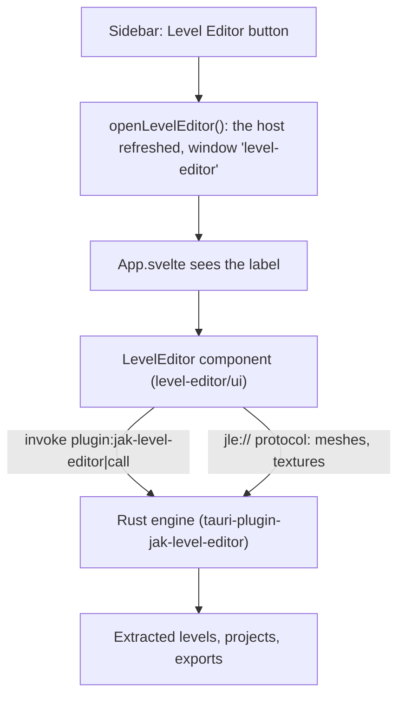
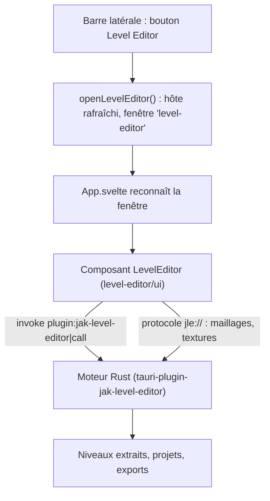

> **Language / Langue :** [🇬🇧 English Version](#-english-version) &nbsp;•&nbsp; [🇫🇷 Version Française](#-version-française)

## Summary / Sommaire

- [🇬🇧 English Version](#-english-version)
  - [1. What This Feature Brings](#1-what-this-feature-brings)
  - [2. How the Feature Works](#2-how-the-feature-works)
  - [3. How it Integrates into the Architecture](#3-how-it-integrates-into-the-architecture)
  - [4. New Files Created](#4-new-files-created)
  - [5. Overview of Changes from the Original Project](#5-overview-of-changes-from-the-original-project)
- [🇫🇷 Version Française](#-version-française)
  - [1. Qu'est-ce qu'elle apporte](#1-quest-ce-quelle-apporte)
  - [2. Comment fonctionne la fonctionnalité](#2-comment-fonctionne-la-fonctionnalité)
  - [3. Comment elle s'intègre dans l'architecture](#3-comment-elle-sintègre-dans-larchitecture)
  - [4. Quels sont les nouveaux fichiers](#4-quels-sont-les-nouveaux-fichiers)
  - [5. Quels sont les modifications dans les grandes lignes](#5-quels-sont-les-modifications-dans-les-grandes-lignes)

---

# 🇬🇧 English Version

## 1. What This Feature Brings

A **Level Editor** button in the sidebar opens **Jak Level Editor**, a level editor for Jak 3, in a
window of its own. With it you can open any level of the game (read from your own disc), move,
copy and delete its pieces, place objects, prefabs and whole buildings, paint terrain, see the level
lit as the game lights it at any hour, generate the paths creatures walk on, and export the result
as a custom level that OpenGOAL builds and plays. An AI assistant can also drive it (MCP server).

The disc the launcher already extracted is the editor's source, and the editor's extractor is
downloaded the first time it is needed. The editor does not play the levels: it exports them as
files to copy into a jak-project (OpenGOAL's sources), with a README and the guide's tutorial
_Add your level to the game by hand_.

The launcher installs and updates OpenGOAL from the releases of the user's fork
[whozghiar/jak-project](https://github.com/whozghiar/jak-project) instead of upstream's: they carry
the level builder's fixes the editor's levels need, in the jak-project they are added to. Updates
come as usual (the header's icon, the Versions page, the automatic update).

The Level Editor is not offered on macOS for now: the fork's tooling and `ogle-extract` have no
build for it.

The editor is its own project ([open-goal-level-builder](https://github.com/whozghiar/open-goal-level-builder)),
written in Rust and Svelte like the launcher. The launcher only plugs it in: it keeps no copy of
its code.

## 2. How the Feature Works

1. The user clicks **Level Editor** (pencil-and-ruler icon) in the sidebar.

   

2. The launcher opens a second window labelled `level-editor`, maximized, or brings it to the front
   (restored if it was minimized) when it is already open. Closing the launcher's main window leaves
   the editor open; unsaved work is never lost silently (the editor asks before closing).
3. That window loads the launcher's own interface, which sees its label and shows the editor
   instead of the launcher's pages. Like the launcher's window, it has no system frame: the editor
   draws its own title bar (the level's name, an orange dot when it is not saved, minimize,
   maximize, close). Below it come the menus (File, Edit, View, Build, Level, Help), the toolbar
   (move, rotate, scale, topology, terrain, copy, paste, delete, create a prefab, undo, redo), the
   tabs on the left (Levels, Build, Catalog, Prefabs, Groups), the 3D view in the middle, the
   inspector of the selection on the right and a status bar. Its texts follow the launcher's
   language when the editor has it (English, French).
4. The editor speaks to its engine (Rust, running inside the launcher's process) through one Tauri
   command and reads the 3D data of the level through its own `jle://` protocol. The engine lives
   as long as the launcher: a saved level left open when the editor's window is closed is shown
   again when it is reopened; choosing **Don't save** when closing discards the document.
5. The first time, the editor needs the game's levels: **File > Extract game assets** reads Jak 3
   with `ogle-extract` (the editor's extractor, built from OpenGOAL's decompiler). In the launcher:
   - the source is the disc the launcher extracted when Jak 3 was installed
     (`<install>/active/jak3/data/iso_data/jak3`): the disc is not asked again;
   - the library goes by default in `<install>/jak-level-editor`;
   - `ogle-extract` is downloaded the first time from the release of the editor's version, into
     `<install>/jak-level-editor/tools/v<version>/`.

   The editor's preferences (its library, its caches) are the launcher's own, in
   `<launcher's config folder>/jak-level-editor/` (`%APPDATA%/OpenGOAL-Launcher/jak-level-editor`
   on Windows): the standalone editor keeps its own, the two never share a library.

6. After exporting a level for the game, its report offers the guide's tutorial _Add your level to
   the game by hand_: the export's files go into a jak-project, as its README says.



## 3. How it Integrates into the Architecture

- **Source:** the editor's repository is a git submodule in `level-editor/`, pinned to a tag of the
  editor (the commit recorded by the launcher; no branch is followed). Clone the launcher with
  `git clone --recursive`, or run `git submodule update --init` once. To move to a new version of
  the editor:

  ```
  git -C level-editor fetch --tags
  git -C level-editor checkout vX.Y.Z
  git add level-editor
  git commit
  ```

- **Backend:** `src-tauri/Cargo.toml` depends on `level-editor/crates/tauri-plugin`; `main.rs`
  registers it with `Builder::new().prefs_in_app_config()` (the editor's preferences in the
  launcher's config folder). The plugin holds the editor's engine, its one command `call`, its
  `jle://` protocol and its remote control for AI assistants: off unless turned on in the editor's
  File > Settings (port 47821 of this computer, each request with the token the editor writes into
  `remote.json` next to its preferences; an MCP server for this editor reads it there through
  `JLE_PREFS_DIR`).
- **What the launcher gives the editor** (`Host`, [`level-editor/crates/core/src/host.rs`](../../level-editor/crates/core/src/host.rs)):
  [`commands/features/level_editor.rs`](../../src-tauri/src/commands/features/level_editor.rs)
  builds it from the settings (`host()`); `main.rs` gives it with `set_host` once the settings are
  loaded, and `openLevelEditor` again each time the editor's window opens (command
  `refresh_level_editor_host`), so a new installation folder, a game installed or a downloaded
  extractor are seen. The editor uses what it is given and hides what it is not.

  | Field                | Value in the launcher                                                          |
  | :------------------- | :----------------------------------------------------------------------------- |
  | `name`               | `launcher`                                                                     |
  | `default_library`    | `<install>/jak-level-editor`                                                   |
  | `extract_source`     | `<install>/active/jak3/data/iso_data/jak3`, when Jak 3 is installed            |
  | `extractor`          | `<install>/jak-level-editor/tools/v<version>/ogle-extract(.exe)`, once fetched |
  | `extractor_provider` | downloads it (below)                                                           |

- **Downloads:**
  - `ogle-extract`, the one of the editor's version (`EDITOR_VERSION` of the plugin):
    `https://github.com/whozghiar/open-goal-level-builder/releases/download/v<version>/ogle-extract-<platform>.zip`
    (`windows-x64`, `linux-x64`, `macos-x64`, `macos-arm64`; the archive holds `ogle-extract(.exe)`
    and `ogle-extract-data/`), unpacked in a `.part` folder renamed when complete, with its progress
    sent to the editor.
  - It and OpenGOAL's archives (`download_version`) are checked before use: `download_release_asset`
    ([`network.rs`](../../src-tauri/src/util/network.rs)) asks GitHub's API the SHA-256 of the
    release's asset (its `digest`) and deletes a download that differs, or one GitHub gives none for.
  - For tests, `JLE_EXTRACTOR_URL` replaces it (the path of a local archive, not checked).
- **OpenGOAL's releases:** `TOOLING_REPOSITORY` in [`github.ts`](../../src/lib/utils/github.ts)
  (`whozghiar/jak-project`) is the repository `listOfficialReleases` and `getLatestOfficialRelease`
  read, so the Versions page, the header's update icon and the automatic update follow the fork's
  releases. Its workflow `release-tooling.yml` publishes them tagged `vX.Y.Z` or `vX.Y.Z-suffix`
  (`v0.3.9-whozghiar.1`: upstream's version 0.3.9, the fork's first build of it), with the archives
  named as upstream's (`opengoal-windows-<tag>.zip`, `opengoal-linux-<tag>.tar.gz`). A repository
  without any release yet means no update, without an error. The Versions page keeps listing the
  versions installed before that the fork does not publish (upstream's `v0.3.8`), so that one can
  still be chosen again or removed. Such a suffix is not a pre-release of
  X.Y.Z: `tooling_version` ([`config.rs`](../../src-tauri/src/config.rs)) reads the version as
  X.Y.Z for the minimum versions the launcher checks (`does_active_tooling_version_meet_minimum`,
  the tools' arguments); versions are otherwise only compared for equality and sorted by date.
- **What to publish:** a release of the fork made with `release-tooling.yml` from master-dev; and
  the editor's release of its version with `ogle-extract-<platform>.zip`, published (a draft's
  assets cannot be downloaded).
- **Permissions:** the capability `jak-level-editor:default` and the `level-editor` window are added
  to `capabilities/main.json`, with the right to create a webview window.
- **macOS:** `LEVEL_EDITOR_AVAILABLE` ([`window.ts`](../../src/lib/level-editor/window.ts)) hides
  the sidebar's button on macOS.
- **Frontend:** Vite's alias `$level-editor` points to `level-editor/ui`; `App.svelte` mounts
  `<LevelEditor locale={config.locale} />` in the editor's window, as the standalone editor mounts
  it (with its own title bar, since the window has no system frame). The editor has its own
  translations (English, French) and follows the launcher's language. Tailwind scans
  `level-editor/ui` (`@source` in `style.css`); Svelte and Flowbite are deduplicated so the editor
  uses the launcher's copies.
- **Bundle:** the editor's texts and game tables are bundled under `jak-level-editor/`
  (`bundle.resources` in `tauri.conf.json`). `ogle-extract` is not bundled: it is downloaded (the
  editor's `JLE_EXTRACTOR` still gives it a path of your own).
- **CI:** every job of `.github/workflows/` that builds or type-checks the launcher checks out with
  `submodules: recursive`; `level-editor/` is in `.prettierignore` (the editor has its own
  formatting).

## 4. New Files Created

| File                                                                                                       | Role                                    |
| :--------------------------------------------------------------------------------------------------------- | :-------------------------------------- |
| [`.gitmodules`](../../.gitmodules), `level-editor/`                                                        | the editor's repository as a submodule  |
| [`src/lib/level-editor/window.ts`](../../src/lib/level-editor/window.ts)                                   | opens (or focuses) the editor's window  |
| [`src-tauri/src/commands/features/level_editor.rs`](../../src-tauri/src/commands/features/level_editor.rs) | the host, the extractor's download      |
| [`docs/features_ai/features_level_editor.md`](features_level_editor.md)                                    | this document                           |
| [`docs/img/level_editor/capture_1.png`](../img/level_editor/capture_1.png)                                 | the sidebar's button, for this document |

## 5. Overview of Changes from the Original Project

- [`src/components/sidebar/Sidebar.svelte`](../../src/components/sidebar/Sidebar.svelte): the
  **Level Editor** button, above Settings (not on macOS).
- [`src/App.svelte`](../../src/App.svelte): shows the editor, with its own title bar, instead of
  the router in the `level-editor` window.
- [`src-tauri/Cargo.toml`](../../src-tauri/Cargo.toml), [`src-tauri/src/main.rs`](../../src-tauri/src/main.rs):
  the editor's plugin, its host, the command `refresh_level_editor_host`.
- [`src-tauri/src/util/network.rs`](../../src-tauri/src/util/network.rs): `download_file_with_progress`
  (`download_file` uses it), `download_release_asset` (a release's asset checked against its
  SHA-256); [`src-tauri/src/commands/versions.rs`](../../src-tauri/src/commands/versions.rs):
  OpenGOAL's archives downloaded with it.
- [`src/lib/rpc/features.ts`](../../src/lib/rpc/features.ts): `refreshLevelEditorHost`.
- [`src/lib/utils/github.ts`](../../src/lib/utils/github.ts): OpenGOAL's releases read from the fork
  (`TOOLING_REPOSITORY`), no error when it has none.
- [`src/routes/settings/Versions.svelte`](../../src/routes/settings/Versions.svelte): the versions
  installed stay listed even when the fork does not publish them.
- [`src-tauri/src/config.rs`](../../src-tauri/src/config.rs), [`src-tauri/src/commands/config.rs`](../../src-tauri/src/commands/config.rs):
  `tooling_version` (a fork's version meets the minimums of its X.Y.Z).
- [`src-tauri/capabilities/main.json`](../../src-tauri/capabilities/main.json): its permission and
  window.
- [`src-tauri/tauri.conf.json`](../../src-tauri/tauri.conf.json): its resources in the bundle.
- [`vite.config.ts`](../../vite.config.ts), [`tsconfig.json`](../../tsconfig.json),
  [`src/css/style.css`](../../src/css/style.css): the `$level-editor` alias, deduplicated
  packages, Tailwind's scan.
- [`.github/workflows/`](../../.github/workflows/), [`.prettierignore`](../../.prettierignore): the
  submodule checked out in CI, left to its own formatting.
- [`src/assets/translations/en-US.json`](../../src/assets/translations/en-US.json): the button's
  label `sidebar_levelEditor`.

---

# 🇫🇷 Version Française

## 1. Qu'est-ce qu'elle apporte

Un bouton **Level Editor** dans la barre latérale ouvre **Jak Level Editor**, un éditeur de niveaux
pour Jak 3, dans sa propre fenêtre. On peut y ouvrir n'importe quel niveau du jeu (lu depuis son
propre disque), déplacer, copier et supprimer ses éléments, poser des objets, des préfabriqués et
des bâtiments entiers, peindre du terrain, voir le niveau éclairé comme le jeu l'éclaire à toute
heure, générer les chemins des créatures, et exporter le résultat comme un niveau personnalisé
qu'OpenGOAL compile et fait jouer. Un assistant IA peut aussi le piloter (serveur MCP).

Le disque que le launcher a déjà extrait sert de source à l'éditeur, et l'extracteur de l'éditeur
est téléchargé la première fois qu'il sert. L'éditeur ne fait pas jouer les niveaux : il les
exporte sous forme de fichiers à copier dans un jak-project (les sources d'OpenGOAL), avec un
README et le tutoriel du guide _Ajouter votre niveau au jeu à la main_.

Le launcher installe et met à jour OpenGOAL depuis les releases du fork de l'utilisateur
[whozghiar/jak-project](https://github.com/whozghiar/jak-project) au lieu de celles d'origine :
elles contiennent les corrections du constructeur de niveaux dont les niveaux de l'éditeur ont
besoin, dans le jak-project où on les ajoute. Les mises à jour arrivent comme d'habitude (l'icône
de l'en-tête, la page Versions, la mise à jour automatique).

Le Level Editor n'est pas proposé sur macOS pour le moment : l'outillage du fork et `ogle-extract`
n'y sont pas compilés.

L'éditeur est un projet à part ([open-goal-level-builder](https://github.com/whozghiar/open-goal-level-builder)),
écrit en Rust et Svelte comme le launcher. Le launcher se contente de le brancher : il ne garde
aucune copie de son code.

## 2. Comment fonctionne la fonctionnalité

1. L'utilisateur clique sur **Level Editor** (icône crayon et règle) dans la barre latérale.

   

2. Le launcher ouvre une seconde fenêtre nommée `level-editor`, agrandie, ou la ramène au premier
   plan (restaurée si elle était réduite) si elle est déjà ouverte. Fermer la fenêtre principale du
   launcher laisse l'éditeur ouvert ; un travail non enregistré n'est jamais perdu en silence
   (l'éditeur demande avant de fermer).
3. Cette fenêtre charge l'interface du launcher, qui reconnaît son nom et affiche l'éditeur à la
   place des pages du launcher. Comme la fenêtre du launcher, elle n'a pas de cadre système :
   l'éditeur dessine sa propre barre de titre (le nom du niveau, un point orange s'il n'est pas
   enregistré, réduire, agrandir, fermer). Dessous viennent les menus (Fichier, Édition, Affichage,
   Construire, Niveau, Aide), la barre d'outils (déplacer, pivoter, échelle, topologie, terrain,
   copier, coller, supprimer, créer un préfabriqué, annuler, rétablir), les onglets à gauche
   (Niveaux, Construire, Catalogue, Préfabriqués, Groupes), la vue 3D au centre, l'inspecteur de la
   sélection à droite et une barre d'état. Ses textes suivent la langue du launcher quand
   l'éditeur la connaît (anglais, français).
4. L'éditeur parle à son moteur (Rust, dans le processus du launcher) par une seule commande Tauri
   et lit les données 3D du niveau par son propre protocole `jle://`. Le moteur vit aussi longtemps
   que le launcher : un niveau enregistré resté ouvert quand on ferme la fenêtre de l'éditeur
   réapparaît quand on la rouvre ; choisir **Ne pas enregistrer** en fermant abandonne le document.
5. La première fois, l'éditeur a besoin des niveaux du jeu : **Fichier > Extraire les données du
   jeu** lit Jak 3 avec `ogle-extract` (l'extracteur de l'éditeur, tiré du décompilateur
   d'OpenGOAL). Dans le launcher :
   - la source est le disque que le launcher a extrait à l'installation de Jak 3
     (`<install>/active/jak3/data/iso_data/jak3`) : le disque n'est pas redemandé ;
   - la bibliothèque va par défaut dans `<install>/jak-level-editor` ;
   - `ogle-extract` est téléchargé la première fois depuis la release de la version de l'éditeur,
     dans `<install>/jak-level-editor/tools/v<version>/`.

   Les préférences de l'éditeur (sa bibliothèque, ses caches) sont propres au launcher, dans
   `<dossier de config du launcher>/jak-level-editor/` (`%APPDATA%/OpenGOAL-Launcher/jak-level-editor`
   sous Windows) : l'éditeur autonome garde les siennes, les deux ne partagent jamais de
   bibliothèque.

6. Après avoir exporté un niveau pour le jeu, son rapport propose le tutoriel du guide _Ajouter
   votre niveau au jeu à la main_ : les fichiers de l'export vont dans un jak-project, comme
   l'indique son README.



## 3. Comment elle s'intègre dans l'architecture

- **Source :** le dépôt de l'éditeur est un sous-module git dans `level-editor/`, fixé sur un tag de
  l'éditeur (le commit enregistré par le launcher ; aucune branche n'est suivie). Cloner le
  launcher avec `git clone --recursive`, ou lancer une fois `git submodule update --init`. Pour
  passer à une nouvelle version de l'éditeur :

  ```
  git -C level-editor fetch --tags
  git -C level-editor checkout vX.Y.Z
  git add level-editor
  git commit
  ```

- **Backend :** `src-tauri/Cargo.toml` dépend de `level-editor/crates/tauri-plugin` ; `main.rs`
  l'enregistre avec `Builder::new().prefs_in_app_config()` (les préférences de l'éditeur dans le
  dossier de config du launcher). Le plugin contient le moteur de l'éditeur, son unique commande
  `call`, son protocole `jle://` et sa télécommande pour les assistants IA : désactivée sauf si on
  l'active dans Fichier > Paramètres de l'éditeur (port 47821 de cet ordinateur, chaque requête
  avec le jeton que l'éditeur écrit dans `remote.json` à côté de ses préférences ; un serveur MCP
  pour cet éditeur l'y lit grâce à `JLE_PREFS_DIR`).
- **Ce que le launcher donne à l'éditeur** (`Host`, [`level-editor/crates/core/src/host.rs`](../../level-editor/crates/core/src/host.rs)) :
  [`commands/features/level_editor.rs`](../../src-tauri/src/commands/features/level_editor.rs) le
  construit à partir des réglages (`host()`) ; `main.rs` le donne avec `set_host` une fois les
  réglages chargés, et `openLevelEditor` à nouveau à chaque ouverture de la fenêtre de l'éditeur
  (commande `refresh_level_editor_host`), pour qu'un nouveau dossier d'installation, un jeu
  installé ou un extracteur téléchargé soient pris en compte. L'éditeur utilise ce qu'on lui donne
  et cache le reste.

  | Champ                | Valeur dans le launcher                                                           |
  | :------------------- | :-------------------------------------------------------------------------------- |
  | `name`               | `launcher`                                                                        |
  | `default_library`    | `<install>/jak-level-editor`                                                      |
  | `extract_source`     | `<install>/active/jak3/data/iso_data/jak3`, quand Jak 3 est installé              |
  | `extractor`          | `<install>/jak-level-editor/tools/v<version>/ogle-extract(.exe)`, une fois obtenu |
  | `extractor_provider` | le télécharge (ci-dessous)                                                        |

- **Téléchargements :**
  - `ogle-extract`, celui de la version de l'éditeur (`EDITOR_VERSION` du plugin) :
    `https://github.com/whozghiar/open-goal-level-builder/releases/download/v<version>/ogle-extract-<plateforme>.zip`
    (`windows-x64`, `linux-x64`, `macos-x64`, `macos-arm64` ; l'archive contient
    `ogle-extract(.exe)` et `ogle-extract-data/`), décompressé dans un dossier `.part` renommé une
    fois complet, sa progression envoyée à l'éditeur.
  - Lui et les archives d'OpenGOAL (`download_version`) sont vérifiés avant usage :
    `download_release_asset` ([`network.rs`](../../src-tauri/src/util/network.rs)) demande à l'API
    de GitHub le SHA-256 de l'asset de la release (son `digest`) et supprime un téléchargement qui
    diffère, ou pour lequel GitHub n'en donne pas.
  - Pour les tests, `JLE_EXTRACTOR_URL` le remplace (le chemin d'une archive locale, non vérifiée).
- **Les releases d'OpenGOAL :** `TOOLING_REPOSITORY` dans [`github.ts`](../../src/lib/utils/github.ts)
  (`whozghiar/jak-project`) est le dépôt que lisent `listOfficialReleases` et
  `getLatestOfficialRelease` : la page Versions, l'icône de mise à jour de l'en-tête et la mise à
  jour automatique suivent les releases du fork. Son workflow `release-tooling.yml` les publie avec
  un tag `vX.Y.Z` ou `vX.Y.Z-suffixe` (`v0.3.9-whozghiar.1` : la version 0.3.9 d'origine, la première
  construction du fork), les archives nommées comme celles d'origine (`opengoal-windows-<tag>.zip`,
  `opengoal-linux-<tag>.tar.gz`). Un dépôt encore sans release signifie pas de mise à jour, sans
  erreur. La page Versions continue de lister les versions installées avant que le fork ne publie
  pas (la `v0.3.8` d'origine), pour pouvoir encore la choisir de nouveau ou la supprimer. Un tel suffixe n'est pas une pré-version de X.Y.Z : `tooling_version`
  ([`config.rs`](../../src-tauri/src/config.rs)) lit la version comme X.Y.Z pour les versions
  minimales que vérifie le launcher (`does_active_tooling_version_meet_minimum`, les arguments des
  outils) ; ailleurs les versions ne sont comparées que par égalité et triées par date.
- **Ce qu'il faut publier :** une release du fork faite avec `release-tooling.yml` depuis
  master-dev ; et la release de l'éditeur de sa version avec `ogle-extract-<plateforme>.zip`,
  publiée (les fichiers d'un brouillon ne se téléchargent pas).
- **Permissions :** la capacité `jak-level-editor:default` et la fenêtre `level-editor` sont ajoutées
  à `capabilities/main.json`, avec le droit de créer une fenêtre webview.
- **macOS :** `LEVEL_EDITOR_AVAILABLE` ([`window.ts`](../../src/lib/level-editor/window.ts)) cache
  le bouton de la barre latérale sur macOS.
- **Frontend :** l'alias Vite `$level-editor` pointe vers `level-editor/ui` ; `App.svelte` affiche
  `<LevelEditor locale={config.locale} />` dans la fenêtre de l'éditeur, comme l'éditeur autonome
  le monte (avec sa propre barre de titre, puisque la fenêtre n'a pas de cadre système). L'éditeur
  a ses propres traductions (anglais, français) et suit la langue du launcher. Tailwind analyse
  `level-editor/ui` (`@source` dans `style.css`) ; Svelte et Flowbite sont dédupliqués pour que
  l'éditeur utilise les copies du launcher.
- **Paquet :** les textes et tables du jeu de l'éditeur sont embarqués sous `jak-level-editor/`
  (`bundle.resources` dans `tauri.conf.json`). `ogle-extract` n'est pas embarqué : il est téléchargé
  (le `JLE_EXTRACTOR` de l'éditeur permet toujours d'en donner un à soi).
- **CI :** chaque tâche de `.github/workflows/` qui compile ou vérifie les types du launcher fait son
  checkout avec `submodules: recursive` ; `level-editor/` est dans `.prettierignore` (l'éditeur a
  son propre formatage).

## 4. Quels sont les nouveaux fichiers

| Fichier                                                                                                    | Rôle                                                   |
| :--------------------------------------------------------------------------------------------------------- | :----------------------------------------------------- |
| [`.gitmodules`](../../.gitmodules), `level-editor/`                                                        | le dépôt de l'éditeur en sous-module                   |
| [`src/lib/level-editor/window.ts`](../../src/lib/level-editor/window.ts)                                   | ouvre (ou met au premier plan) la fenêtre de l'éditeur |
| [`src-tauri/src/commands/features/level_editor.rs`](../../src-tauri/src/commands/features/level_editor.rs) | l'hôte, le téléchargement de l'extracteur              |
| [`docs/features_ai/features_level_editor.md`](features_level_editor.md)                                    | ce document                                            |
| [`docs/img/level_editor/capture_1.png`](../img/level_editor/capture_1.png)                                 | le bouton de la barre latérale, pour ce document       |

## 5. Quels sont les modifications dans les grandes lignes

- [`src/components/sidebar/Sidebar.svelte`](../../src/components/sidebar/Sidebar.svelte) : le bouton
  **Level Editor**, au-dessus des Paramètres (pas sur macOS).
- [`src/App.svelte`](../../src/App.svelte) : affiche l'éditeur, avec sa propre barre de titre, à la
  place du routeur dans la fenêtre `level-editor`.
- [`src-tauri/Cargo.toml`](../../src-tauri/Cargo.toml), [`src-tauri/src/main.rs`](../../src-tauri/src/main.rs) :
  le plugin de l'éditeur, son hôte, la commande `refresh_level_editor_host`.
- [`src-tauri/src/util/network.rs`](../../src-tauri/src/util/network.rs) : `download_file_with_progress`
  (`download_file` l'utilise), `download_release_asset` (l'asset d'une release vérifié par son
  SHA-256) ; [`src-tauri/src/commands/versions.rs`](../../src-tauri/src/commands/versions.rs) : les
  archives d'OpenGOAL téléchargées avec.
- [`src/lib/rpc/features.ts`](../../src/lib/rpc/features.ts) : `refreshLevelEditorHost`.
- [`src/lib/utils/github.ts`](../../src/lib/utils/github.ts) : les releases d'OpenGOAL lues depuis
  le fork (`TOOLING_REPOSITORY`), sans erreur quand il n'en a aucune.
- [`src/routes/settings/Versions.svelte`](../../src/routes/settings/Versions.svelte) : les versions
  installées restent listées même quand le fork ne les publie pas.
- [`src-tauri/src/config.rs`](../../src-tauri/src/config.rs), [`src-tauri/src/commands/config.rs`](../../src-tauri/src/commands/config.rs) :
  `tooling_version` (une version du fork atteint les minimums de son X.Y.Z).
- [`src-tauri/capabilities/main.json`](../../src-tauri/capabilities/main.json) : sa permission et sa
  fenêtre.
- [`src-tauri/tauri.conf.json`](../../src-tauri/tauri.conf.json) : ses ressources dans le paquet.
- [`vite.config.ts`](../../vite.config.ts), [`tsconfig.json`](../../tsconfig.json),
  [`src/css/style.css`](../../src/css/style.css) : l'alias `$level-editor`, les paquets dédupliqués,
  l'analyse de Tailwind.
- [`.github/workflows/`](../../.github/workflows/), [`.prettierignore`](../../.prettierignore) : le
  sous-module récupéré en CI, laissé à son propre formatage.
- [`src/assets/translations/en-US.json`](../../src/assets/translations/en-US.json) : le libellé du
  bouton `sidebar_levelEditor`.
