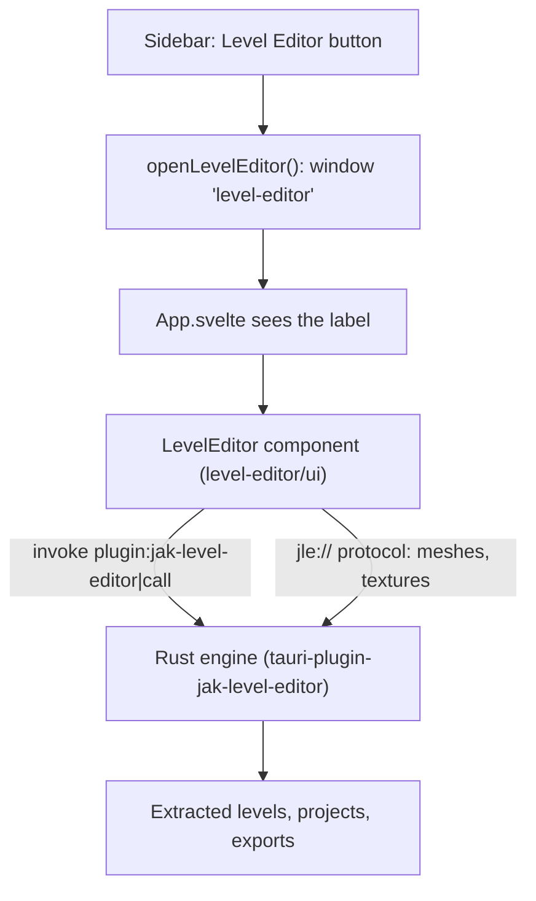
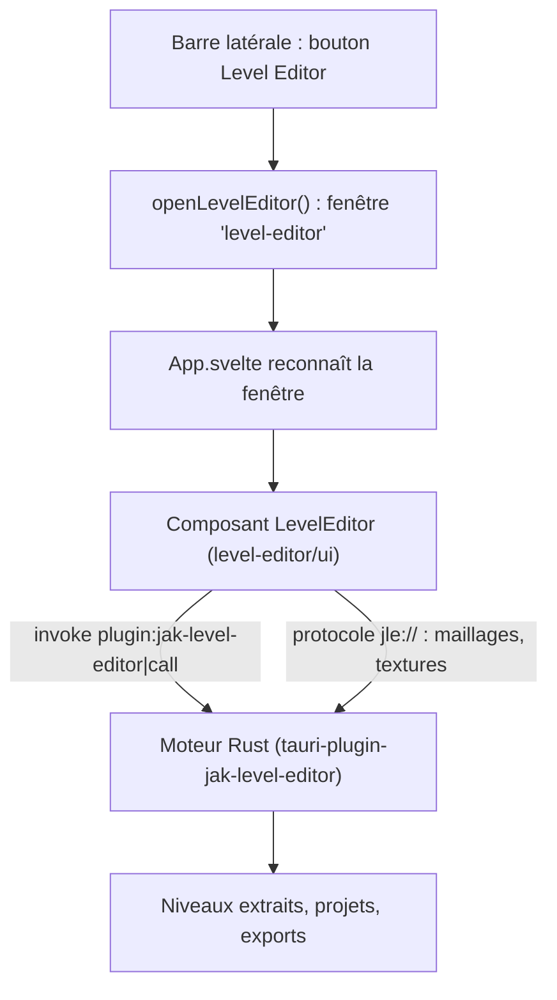

> **Language / Langue :** [🇬🇧 English Version](#-english-version) &nbsp;•&nbsp; [🇫🇷 Version Française](#-version-française)

## Summary / Sommaire

- [🇬🇧 English Version](#-english-version)
  - [1. What This Feature Brings](#1-what-this-feature-brings)
  - [2. How the Feature Works](#2-how-the-feature-works)
  - [3. How it Integrates into the Architecture](#3-how-it-integrates-into-the-architecture)
  - [4. New Files Created](#4-new-files-created)
  - [5. Overview of Changes from the Original Project](#5-overview-of-changes-from-the-original-project)
- [🇫🇷 Version Française](#-version-française)
  - [1. Qu'est-ce qu'elle apporte](#1-quest-ce-quelle-apporte)
  - [2. Comment fonctionne la fonctionnalité](#2-comment-fonctionne-la-fonctionnalité)
  - [3. Comment elle s'intègre dans l'architecture](#3-comment-elle-sintègre-dans-larchitecture)
  - [4. Quels sont les nouveaux fichiers](#4-quels-sont-les-nouveaux-fichiers)
  - [5. Quels sont les modifications dans les grandes lignes](#5-quels-sont-les-modifications-dans-les-grandes-lignes)

---

# 🇬🇧 English Version

## 1. What This Feature Brings

A **Level Editor** button in the sidebar opens **Jak Level Editor**, a level editor for Jak 3, in a
window of its own. With it you can open any level of the game (read from your own disc), move,
copy and delete its pieces, place objects, prefabs and whole buildings, paint terrain, see the level
lit as the game lights it at any hour, generate the paths creatures walk on, and export the result
as a custom level that OpenGOAL builds and plays. An AI assistant can also drive it (MCP server).

The editor is its own project ([open-goal-level-builder](https://github.com/whozghiar/open-goal-level-builder),
branch `rewrite/rust`), written in Rust and Svelte like the launcher. The launcher only plugs it in:
it keeps no copy of its code.

## 2. How the Feature Works

1. The user clicks **Level Editor** (pencil-and-ruler icon) in the sidebar.

   

2. The launcher opens a second window labelled `level-editor`, maximized, or brings it to the front
   (restored if it was minimized) when it is already open. Closing the launcher's main window leaves
   the editor open; unsaved work is never lost silently (the editor asks before closing).
3. That window loads the launcher's own interface, which sees its label and shows the editor
   instead of the launcher's pages. Like the launcher's window, it has no system frame: the editor
   draws its own title bar (the level's name, an orange dot when it is not saved, minimize,
   maximize, close). Below it come the menus (File, Edit, View, Build, Level, Help), the toolbar
   (move, rotate, scale, topology, terrain, copy, paste, delete, create a prefab, undo, redo), the
   tabs on the left (Levels, Build, Catalog, Prefabs, Groups), the 3D view in the middle, the
   inspector of the selection on the right and a status bar. Its texts follow the launcher's
   language when the editor has it (English, French).
4. The editor speaks to its engine (Rust, running inside the launcher's process) through one Tauri
   command and reads the 3D data of the level through its own `jle://` protocol. The engine lives
   as long as the launcher: a saved level left open when the editor's window is closed is shown
   again when it is reopened; choosing **Don't save** when closing discards the document.
5. The first time, the editor needs the game's levels: **File > Extract game assets** reads the
   user's Jak 3 disc image with `ogle-extract` (the editor's extractor, built from OpenGOAL's
   decompiler). The levels, preferences and projects are shared with the standalone editor
   (`%APPDATA%/OpenGOAL/jak-level-editor`).

## 3. How it Integrates into the Architecture

- **Source:** the editor's repository is a git submodule in `level-editor/` (branch
  `rewrite/rust`). Updating the editor is `git submodule update --remote level-editor`.
- **Backend:** `src-tauri/Cargo.toml` depends on `level-editor/crates/tauri-plugin`; `main.rs`
  registers it with `.plugin(tauri_plugin_jak_level_editor::init())`. The plugin holds the editor's
  engine, its one command `call`, its `jle://` protocol and its remote control for AI assistants
  (port 47821: one editor at a time can hold it, so while the standalone editor runs, the
  launcher's says in its log that the remote control is unavailable).
- **Permissions:** the capability `jak-level-editor:default` and the `level-editor` window are added
  to `capabilities/main.json`, with the right to create a webview window.
- **Frontend:** Vite's alias `$level-editor` points to `level-editor/ui`; `App.svelte` mounts
  `<LevelEditor locale={config.locale} />` in the editor's window, as the standalone editor mounts
  it (with its own title bar, since the window has no system frame). The editor has its own
  translations (English, French) and follows the launcher's language. Tailwind scans
  `level-editor/ui` (`@source` in `style.css`); Svelte and Flowbite are deduplicated so the editor
  uses the launcher's copies.
- **Bundle:** the editor's texts and game tables are bundled under `jak-level-editor/`
  (`bundle.resources` in `tauri.conf.json`). `ogle-extract` is not bundled yet: build it from
  `level-editor/` with CMake (`cmake -S level-editor -B level-editor/build -G Ninja` then
  `cmake --build level-editor/build`) and the editor finds it there, or set `JLE_EXTRACTOR` to the
  path of `ogle-extract.exe`. Until then, the editor's Extract window says that `ogle-extract` is
  missing and where it looked.

## 4. New Files Created

| File                                                                       | Role                                    |
| :------------------------------------------------------------------------- | :-------------------------------------- |
| [`.gitmodules`](../../.gitmodules), `level-editor/`                        | the editor's repository as a submodule  |
| [`src/lib/level-editor/window.ts`](../../src/lib/level-editor/window.ts)   | opens (or focuses) the editor's window  |
| [`docs/features_ai/features_level_editor.md`](features_level_editor.md)    | this document                           |
| [`docs/img/level_editor/capture_1.png`](../img/level_editor/capture_1.png) | the sidebar's button, for this document |

## 5. Overview of Changes from the Original Project

- [`src/components/sidebar/Sidebar.svelte`](../../src/components/sidebar/Sidebar.svelte): the
  **Level Editor** button, above Settings.
- [`src/App.svelte`](../../src/App.svelte): shows the editor, with its own title bar, instead of
  the router in the `level-editor` window.
- [`src-tauri/Cargo.toml`](../../src-tauri/Cargo.toml), [`src-tauri/src/main.rs`](../../src-tauri/src/main.rs):
  the editor's plugin.
- [`src-tauri/capabilities/main.json`](../../src-tauri/capabilities/main.json): its permission and
  window.
- [`src-tauri/tauri.conf.json`](../../src-tauri/tauri.conf.json): its resources in the bundle.
- [`vite.config.ts`](../../vite.config.ts), [`tsconfig.json`](../../tsconfig.json),
  [`src/css/style.css`](../../src/css/style.css): the `$level-editor` alias, deduplicated
  packages, Tailwind's scan.
- [`src/assets/translations/en-US.json`](../../src/assets/translations/en-US.json): the button's
  label, `sidebar_levelEditor`.

---

# 🇫🇷 Version Française

## 1. Qu'est-ce qu'elle apporte

Un bouton **Level Editor** dans la barre latérale ouvre **Jak Level Editor**, un éditeur de niveaux
pour Jak 3, dans sa propre fenêtre. On peut y ouvrir n'importe quel niveau du jeu (lu depuis son
propre disque), déplacer, copier et supprimer ses éléments, poser des objets, des préfabriqués et
des bâtiments entiers, peindre du terrain, voir le niveau éclairé comme le jeu l'éclaire à toute
heure, générer les chemins des créatures, et exporter le résultat comme un niveau personnalisé
qu'OpenGOAL compile et fait jouer. Un assistant IA peut aussi le piloter (serveur MCP).

L'éditeur est un projet à part ([open-goal-level-builder](https://github.com/whozghiar/open-goal-level-builder),
branche `rewrite/rust`), écrit en Rust et Svelte comme le launcher. Le launcher se contente de le
brancher : il ne garde aucune copie de son code.

## 2. Comment fonctionne la fonctionnalité

1. L'utilisateur clique sur **Level Editor** (icône crayon et règle) dans la barre latérale.

   

2. Le launcher ouvre une seconde fenêtre nommée `level-editor`, agrandie, ou la ramène au premier
   plan (restaurée si elle était réduite) si elle est déjà ouverte. Fermer la fenêtre principale du
   launcher laisse l'éditeur ouvert ; un travail non enregistré n'est jamais perdu en silence
   (l'éditeur demande avant de fermer).
3. Cette fenêtre charge l'interface du launcher, qui reconnaît son nom et affiche l'éditeur à la
   place des pages du launcher. Comme la fenêtre du launcher, elle n'a pas de cadre système :
   l'éditeur dessine sa propre barre de titre (le nom du niveau, un point orange s'il n'est pas
   enregistré, réduire, agrandir, fermer). Dessous viennent les menus (Fichier, Édition, Affichage,
   Construire, Niveau, Aide), la barre d'outils (déplacer, pivoter, échelle, topologie, terrain,
   copier, coller, supprimer, créer un préfabriqué, annuler, rétablir), les onglets à gauche
   (Niveaux, Construire, Catalogue, Préfabriqués, Groupes), la vue 3D au centre, l'inspecteur de la
   sélection à droite et une barre d'état. Ses textes suivent la langue du launcher quand
   l'éditeur la connaît (anglais, français).
4. L'éditeur parle à son moteur (Rust, dans le processus du launcher) par une seule commande Tauri
   et lit les données 3D du niveau par son propre protocole `jle://`. Le moteur vit aussi longtemps
   que le launcher : un niveau enregistré resté ouvert quand on ferme la fenêtre de l'éditeur
   réapparaît quand on la rouvre ; choisir **Ne pas enregistrer** en fermant abandonne le document.
5. La première fois, l'éditeur a besoin des niveaux du jeu : **Fichier > Extraire les données du
   jeu** lit l'image disque de Jak 3 de l'utilisateur avec `ogle-extract` (l'extracteur de
   l'éditeur, tiré du décompilateur d'OpenGOAL). Les niveaux, préférences et projets sont partagés
   avec l'éditeur autonome (`%APPDATA%/OpenGOAL/jak-level-editor`).

## 3. Comment elle s'intègre dans l'architecture

- **Source :** le dépôt de l'éditeur est un sous-module git dans `level-editor/` (branche
  `rewrite/rust`). Mettre l'éditeur à jour : `git submodule update --remote level-editor`.
- **Backend :** `src-tauri/Cargo.toml` dépend de `level-editor/crates/tauri-plugin` ; `main.rs`
  l'enregistre avec `.plugin(tauri_plugin_jak_level_editor::init())`. Le plugin contient le moteur
  de l'éditeur, son unique commande `call`, son protocole `jle://` et sa télécommande pour les
  assistants IA (port 47821 : un seul éditeur à la fois peut l'occuper, donc tant que l'éditeur
  autonome tourne, celui du launcher indique dans son journal que la télécommande est
  indisponible).
- **Permissions :** la capacité `jak-level-editor:default` et la fenêtre `level-editor` sont ajoutées
  à `capabilities/main.json`, avec le droit de créer une fenêtre webview.
- **Frontend :** l'alias Vite `$level-editor` pointe vers `level-editor/ui` ; `App.svelte` affiche
  `<LevelEditor locale={config.locale} />` dans la fenêtre de l'éditeur, comme l'éditeur autonome
  le monte (avec sa propre barre de titre, puisque la fenêtre n'a pas de cadre système). L'éditeur
  a ses propres traductions (anglais, français) et suit la langue du launcher. Tailwind analyse
  `level-editor/ui` (`@source` dans `style.css`) ; Svelte et Flowbite sont dédupliqués pour que
  l'éditeur utilise les copies du launcher.
- **Paquet :** les textes et tables du jeu de l'éditeur sont embarqués sous `jak-level-editor/`
  (`bundle.resources` dans `tauri.conf.json`). `ogle-extract` n'est pas encore embarqué : le
  compiler depuis `level-editor/` avec CMake (`cmake -S level-editor -B level-editor/build -G Ninja`
  puis `cmake --build level-editor/build`) et l'éditeur le trouve là, ou définir `JLE_EXTRACTOR`
  avec le chemin de `ogle-extract.exe`. En attendant, la fenêtre d'extraction de l'éditeur indique
  qu'`ogle-extract` manque et où elle l'a cherché.

## 4. Quels sont les nouveaux fichiers

| Fichier                                                                    | Rôle                                                   |
| :------------------------------------------------------------------------- | :----------------------------------------------------- |
| [`.gitmodules`](../../.gitmodules), `level-editor/`                        | le dépôt de l'éditeur en sous-module                   |
| [`src/lib/level-editor/window.ts`](../../src/lib/level-editor/window.ts)   | ouvre (ou met au premier plan) la fenêtre de l'éditeur |
| [`docs/features_ai/features_level_editor.md`](features_level_editor.md)    | ce document                                            |
| [`docs/img/level_editor/capture_1.png`](../img/level_editor/capture_1.png) | le bouton de la barre latérale, pour ce document       |

## 5. Quels sont les modifications dans les grandes lignes

- [`src/components/sidebar/Sidebar.svelte`](../../src/components/sidebar/Sidebar.svelte) : le bouton
  **Level Editor**, au-dessus des Paramètres.
- [`src/App.svelte`](../../src/App.svelte) : affiche l'éditeur, avec sa propre barre de titre, à la
  place du routeur dans la fenêtre `level-editor`.
- [`src-tauri/Cargo.toml`](../../src-tauri/Cargo.toml), [`src-tauri/src/main.rs`](../../src-tauri/src/main.rs) :
  le plugin de l'éditeur.
- [`src-tauri/capabilities/main.json`](../../src-tauri/capabilities/main.json) : sa permission et sa
  fenêtre.
- [`src-tauri/tauri.conf.json`](../../src-tauri/tauri.conf.json) : ses ressources dans le paquet.
- [`vite.config.ts`](../../vite.config.ts), [`tsconfig.json`](../../tsconfig.json),
  [`src/css/style.css`](../../src/css/style.css) : l'alias `$level-editor`, les paquets dédupliqués,
  l'analyse de Tailwind.
- [`src/assets/translations/en-US.json`](../../src/assets/translations/en-US.json) : le libellé du
  bouton, `sidebar_levelEditor`.
