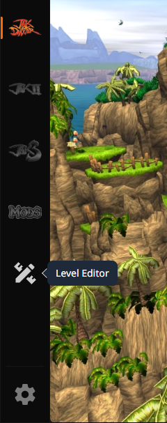
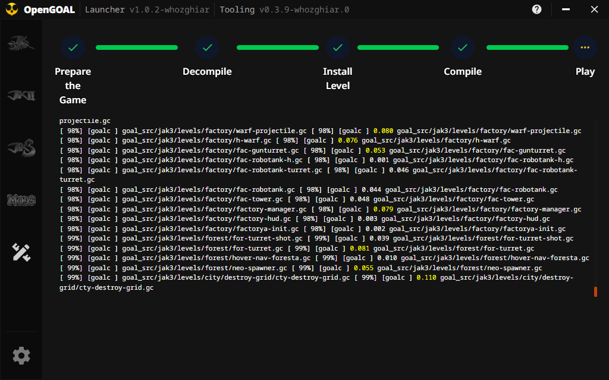
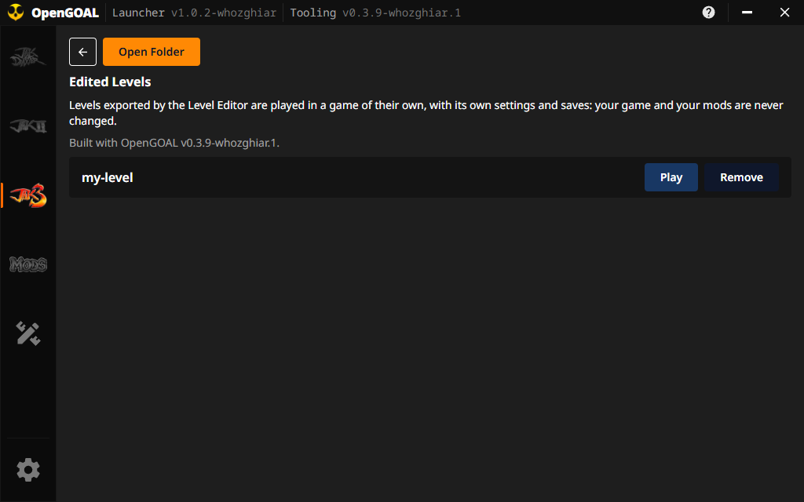
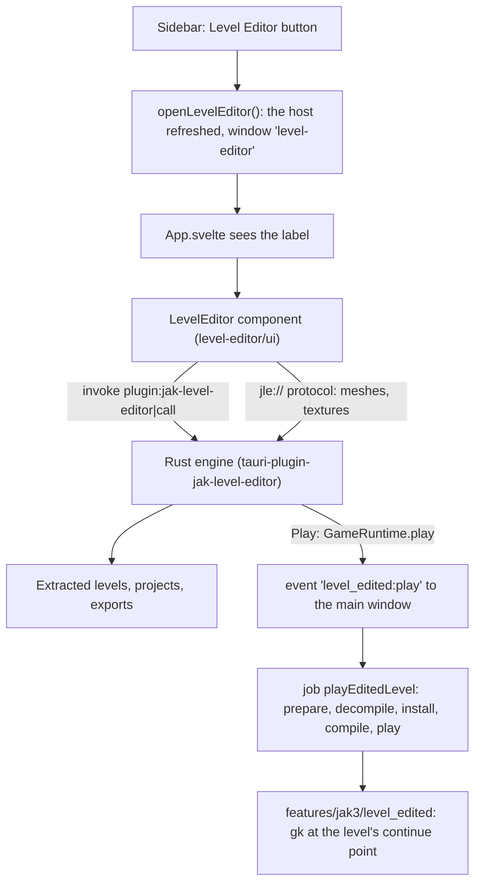
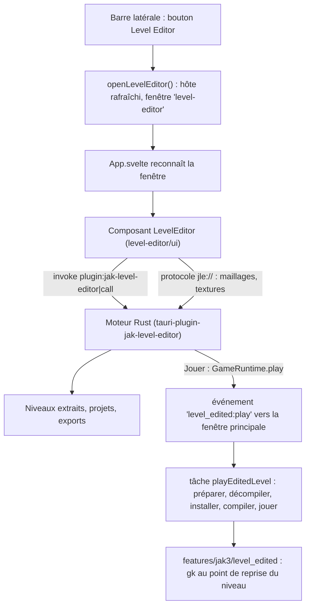

> **Language / Langue :** [🇬🇧 English Version](#-english-version) &nbsp;•&nbsp; [🇫🇷 Version Française](#-version-française)

## Summary / Sommaire

- [🇬🇧 English Version](#-english-version)
  - [1. What This Feature Brings](#1-what-this-feature-brings)
  - [2. How the Feature Works](#2-how-the-feature-works)
  - [3. How it Integrates into the Architecture](#3-how-it-integrates-into-the-architecture)
  - [4. New Files Created](#4-new-files-created)
  - [5. Overview of Changes from the Original Project](#5-overview-of-changes-from-the-original-project)
- [🇫🇷 Version Française](#-version-française)
  - [1. Qu'est-ce qu'elle apporte](#1-quest-ce-quelle-apporte)
  - [2. Comment fonctionne la fonctionnalité](#2-comment-fonctionne-la-fonctionnalité)
  - [3. Comment elle s'intègre dans l'architecture](#3-comment-elle-sintègre-dans-larchitecture)
  - [4. Quels sont les nouveaux fichiers](#4-quels-sont-les-nouveaux-fichiers)
  - [5. Quels sont les modifications dans les grandes lignes](#5-quels-sont-les-modifications-dans-les-grandes-lignes)

---

# 🇬🇧 English Version

## 1. What This Feature Brings

A **Level Editor** button in the sidebar opens **Jak Level Editor**, a level editor for Jak 3, in a
window of its own. With it you can open any level of the game (read from your own disc), move,
copy and delete its pieces, place objects, prefabs and whole buildings, paint terrain, see the level
lit as the game lights it at any hour, generate the paths creatures walk on, and export the result
as a custom level that OpenGOAL builds and plays. An AI assistant can also drive it (MCP server).

In the launcher, the editor also **plays** what you build: its **Play** button installs the level
in a game of its own, apart from your Jak 3, its saves and your mods, and starts it there, with the
launcher's progress page. The disc the launcher already extracted is the editor's source, and the
editor's extractor is downloaded the first time it is needed.

The launcher installs and updates OpenGOAL from the releases of the user's fork
[whozghiar/jak-project](https://github.com/whozghiar/jak-project) instead of upstream's: they carry
the level builder's fixes the editor's levels need. Updates come as usual (the header's icon, the
Versions page, the automatic update), and the editor's game always uses the active version: nothing
else is downloaded.

The editor is its own project ([open-goal-level-builder](https://github.com/whozghiar/open-goal-level-builder)),
written in Rust and Svelte like the launcher. The launcher only plugs it in: it keeps no copy of
its code.

## 2. How the Feature Works

1. The user clicks **Level Editor** (pencil-and-ruler icon) in the sidebar.

   

2. The launcher opens a second window labelled `level-editor`, maximized, or brings it to the front
   (restored if it was minimized) when it is already open. Closing the launcher's main window leaves
   the editor open; unsaved work is never lost silently (the editor asks before closing).
3. That window loads the launcher's own interface, which sees its label and shows the editor
   instead of the launcher's pages. Like the launcher's window, it has no system frame: the editor
   draws its own title bar (the level's name, an orange dot when it is not saved, minimize,
   maximize, close). Below it come the menus (File, Edit, View, Build, Level, Help), the toolbar
   (move, rotate, scale, topology, terrain, copy, paste, delete, create a prefab, undo, redo), the
   tabs on the left (Levels, Build, Catalog, Prefabs, Groups), the 3D view in the middle, the
   inspector of the selection on the right and a status bar. Its texts follow the launcher's
   language when the editor has it (English, French).
4. The editor speaks to its engine (Rust, running inside the launcher's process) through one Tauri
   command and reads the 3D data of the level through its own `jle://` protocol. The engine lives
   as long as the launcher: a saved level left open when the editor's window is closed is shown
   again when it is reopened; choosing **Don't save** when closing discards the document.
5. The first time, the editor needs the game's levels: **File > Extract game assets** reads Jak 3
   with `ogle-extract` (the editor's extractor, built from OpenGOAL's decompiler). In the launcher:
   - the source is the disc the launcher extracted when Jak 3 was installed
     (`<install>/active/jak3/data/iso_data/jak3`): the disc is not asked again;
   - the library goes by default in `<install>/jak-level-editor`;
   - `ogle-extract` is downloaded the first time from the release of the editor's version, into
     `<install>/jak-level-editor/tools/v<version>/`.

   The preferences are shared with the standalone editor (`%APPDATA%/OpenGOAL/jak-level-editor`).

6. After exporting a level for the game, **Play** in the editor brings the launcher's window to the
   front, which runs a job like a mod's installation, with its steps and its logs:
   1. **Prepare the Game** (the first time, and after each change of OpenGOAL version): the data of
      the active version (`<install>/versions/official/<version>/data`) is copied into
      `<install>/features/jak3/level_edited/data`, and the levels installed before are installed
      again from their copies (`level_edited/packages/`); the settings and saves are kept. A version
      without the level builder (see below) stops here and says so;
   2. **Decompile** (once per version): the active version's extractor decompiles the disc the
      launcher already extracted;
   3. **Install Level**: the level's files are copied into that game's data and registered
      (`game.gp`, `level-info.gc`);
   4. **Compile**: the game is built with the level;
   5. **Play**: the game starts at the level's continue point, with its own settings and saves
      (`level_edited/_settings/`).

   The first Play with a version takes about ten minutes (decompilation, a full build); the next
   ones only build again what changed. A build short of memory can stop on `bad allocation`: press
   Play again.

   

7. On the Jak 3 page, **Advanced > Edited Levels** lists the levels installed in that game, with
   **Play** and **Remove** (the level is taken out and the game built again), and opens its folder.
   It shows the OpenGOAL version the game is built with; after an update it says the game will be
   rebuilt for the new version at the next Play, and its **Play** then runs the same job (prepare,
   decompile, build, play).

   



## 3. How it Integrates into the Architecture

- **Source:** the editor's repository is a git submodule in `level-editor/`, pinned to a tag of the
  editor (the commit recorded by the launcher; no branch is followed). Clone the launcher with
  `git clone --recursive`, or run `git submodule update --init` once. To move to a new version of
  the editor:

  ```
  git -C level-editor fetch --tags
  git -C level-editor checkout vX.Y.Z
  git add level-editor
  git commit
  ```

- **Backend:** `src-tauri/Cargo.toml` depends on `level-editor/crates/tauri-plugin`; `main.rs`
  registers it with `.plugin(tauri_plugin_jak_level_editor::init())`. The plugin holds the editor's
  engine, its one command `call`, its `jle://` protocol and its remote control for AI assistants
  (port 47821: one editor at a time can hold it, so while the standalone editor runs, the
  launcher's says in its log that the remote control is unavailable).
- **What the launcher gives the editor** (`Host`, [`level-editor/crates/core/src/host.rs`](../../level-editor/crates/core/src/host.rs)):
  [`commands/features/level_edited.rs`](../../src-tauri/src/commands/features/level_edited.rs)
  builds it from the settings (`host()`); `main.rs` gives it with `set_host` once the settings are
  loaded, and `openLevelEditor` again each time the editor's window opens (command
  `refresh_level_editor_host`), so a new installation folder, a game installed or a downloaded
  extractor are seen. The editor uses what it is given and hides what it is not.

  | Field                | Value in the launcher                                                                                  |
  | :------------------- | :----------------------------------------------------------------------------------------------------- |
  | `name`               | `launcher`                                                                                             |
  | `default_library`    | `<install>/jak-level-editor`                                                                           |
  | `extract_source`     | `<install>/active/jak3/data/iso_data/jak3`, when Jak 3 is installed                                    |
  | `extractor`          | `<install>/jak-level-editor/tools/v<version>/ogle-extract(.exe)`, once fetched                         |
  | `extractor_provider` | downloads it (below)                                                                                   |
  | `runtime`            | the isolated game `<install>/features/jak3/level_edited/`, run with the programs of the active version |

- **Downloads:**
  - `ogle-extract`, the one of the editor's version (`EDITOR_VERSION` of the plugin):
    `https://github.com/whozghiar/open-goal-level-builder/releases/download/v<version>/ogle-extract-<platform>.zip`
    (`windows-x64`, `linux-x64`, `macos-x64`, `macos-arm64`; the archive holds `ogle-extract(.exe)`
    and `ogle-extract-data/`), unpacked in a `.part` folder renamed when complete, with its progress
    sent to the editor.
  - For tests, `JLE_EXTRACTOR_URL` replaces it (a URL, or the path of a local archive).
- **OpenGOAL's releases:** `TOOLING_REPOSITORY` in [`github.ts`](../../src/lib/utils/github.ts)
  (`whozghiar/jak-project`) is the repository `listOfficialReleases` and `getLatestOfficialRelease`
  read, so the Versions page, the header's update icon and the automatic update follow the fork's
  releases. Its workflow `release-tooling.yml` publishes them tagged `vX.Y.Z` or `vX.Y.Z-suffix`
  (`v0.3.9-whozghiar.1`: upstream's version 0.3.9, the fork's first build of it), with the archives
  named as upstream's (`opengoal-windows-<tag>.zip`, `opengoal-linux-<tag>.tar.gz`). A repository
  without any release yet means no update, without an error. Such a suffix is not a pre-release of
  X.Y.Z: `tooling_version` ([`config.rs`](../../src-tauri/src/config.rs)) reads the version as
  X.Y.Z for the minimum versions the launcher checks (`does_active_tooling_version_meet_minimum`,
  the tools' arguments); versions are otherwise only compared for equality and sorted by date.
- **The level builder:** a version can play the editor's levels when it is one of the fork's
  releases (its tag has the suffix `-whozghiar.N`: the fork's master-dev has the level builder's
  fixes) and Jak 3 is installed (the disc extracted in `active/jak3/data/iso_data/jak3`); otherwise
  the editor has no Play button and the job stops with the reason.
- **The isolated game** `<install>/features/jak3/level_edited/`, like a mod: its own `data/` (the
  decompiled game, the installed levels, the build: `--proj-path`), `_settings/`
  (`gk --config-path`: its settings and saves), `packages/` (a copy of each level installed) and
  `jle-runtime.json` (the version its data was made from, the disc decompiled), run with the
  programs of the active version (`versions/official/<version>/gk`, `goalc`, `extractor`). When the
  active version is not the one in `jle-runtime.json`, the next Play makes `data/` again from that
  version's and installs the levels again from `packages/`. Vanilla `active/`, `versions/` and the
  mods are never changed. This is the editor's code (`jle_core::runtime::launcher_level_edited`,
  `prepare`, `apply_level`, `remove_level_files`), which the standalone editor uses too when it finds
  the launcher's settings.
- **Play:** the runtime's `play` emits `level_edited:play` (the export's folder, the level's name)
  to the main window and brings it to the front; `App.svelte` opens the job `playEditedLevel`
  ([`levelEditedJob.ts`](../../src/lib/job/levelEditedJob.ts)), whose steps call the commands
  `level_edited_prepare_runtime`, `level_edited_decompile`, `level_edited_install_level`,
  `level_edited_compile` and `level_edited_launch`. The launcher runs the tools with its logs; the
  rest is the editor's own code (`jle_core::runtime::OpenGoal`, `jle_core::io::level_package`), which
  its standalone app uses too: the preparation, the installation, the command lines of the
  decompilation and the build (`extractor --folder --decompile` / `--compile`), and the start at the continue point (`gk ... -- -boot -fakeiso -debug`, then
  goalc's REPL running `data/goal_src/user/jle/startup-jak3.gc`, stopped once the level is shown).
  The tools' output goes to the job's logs and `extractor-jak3-level_edited.log`, the game's to
  `level_edited/_settings/jle-game.log`. When the main window is closed, the runtime runs the same
  steps itself. The editor can also call `install_level`, `remove_level` and `launch` directly.
  **Remove** is the job `removeEditedLevel` (`level_edited_remove_level`, then prepare, decompile and
  compile; a game started by Play is stopped before any build). The editor's host is given again
  when the active version changes (`set_active_version`).
- **What to publish:** a release of the fork made with `release-tooling.yml` from master-dev (with
  the level builder's fixes), version `0.3.X-whozghiar.N` (the suffix makes it a version for the
  editor's levels); and the editor's release of its version with `ogle-extract-<platform>.zip`.
- **Permissions:** the capability `jak-level-editor:default` and the `level-editor` window are added
  to `capabilities/main.json`, with the right to create a webview window.
- **Frontend:** Vite's alias `$level-editor` points to `level-editor/ui`; `App.svelte` mounts
  `<LevelEditor locale={config.locale} />` in the editor's window, as the standalone editor mounts
  it (with its own title bar, since the window has no system frame). The editor has its own
  translations (English, French) and follows the launcher's language. Tailwind scans
  `level-editor/ui` (`@source` in `style.css`); Svelte and Flowbite are deduplicated so the editor
  uses the launcher's copies. The **Edited Levels** page is the route `/:game_name/level_edited`.
- **Bundle:** the editor's texts and game tables are bundled under `jak-level-editor/`
  (`bundle.resources` in `tauri.conf.json`). `ogle-extract` is not bundled: it is downloaded (the
  editor's `JLE_EXTRACTOR` still gives it a path of your own).
- **CI:** every job of `.github/workflows/` that builds or type-checks the launcher checks out with
  `submodules: recursive`; `level-editor/` is in `.prettierignore` (the editor has its own
  formatting).

## 4. New Files Created

| File                                                                                                                             | Role                                                         |
| :------------------------------------------------------------------------------------------------------------------------------- | :----------------------------------------------------------- |
| [`.gitmodules`](../../.gitmodules), `level-editor/`                                                                              | the editor's repository as a submodule                       |
| [`src/lib/level-editor/window.ts`](../../src/lib/level-editor/window.ts)                                                         | opens (or focuses) the editor's window                       |
| [`src-tauri/src/commands/features/level_edited.rs`](../../src-tauri/src/commands/features/level_edited.rs)                       | the host, the extractor's download, the isolated game        |
| [`src/lib/job/levelEditedJob.ts`](../../src/lib/job/levelEditedJob.ts)                                                           | the steps of the jobs `playEditedLevel`, `removeEditedLevel` |
| [`src/components/level-edited/EditedLevels.svelte`](../../src/components/level-edited/EditedLevels.svelte)                       | the Edited Levels page                                       |
| [`docs/features_ai/features_level_editor.md`](features_level_editor.md)                                                          | this document                                                |
| [`docs/img/level_editor/capture_1.png`](../img/level_editor/capture_1.png)                                                       | the sidebar's button, for this document                      |
| [`docs/img/level_editor/capture_2.png`](../img/level_editor/capture_2.png), [`capture_3.png`](../img/level_editor/capture_3.png) | the Play job and the Edited Levels page, for this document   |

## 5. Overview of Changes from the Original Project

- [`src/components/sidebar/Sidebar.svelte`](../../src/components/sidebar/Sidebar.svelte): the
  **Level Editor** button, above Settings.
- [`src/App.svelte`](../../src/App.svelte): shows the editor, with its own title bar, instead of
  the router in the `level-editor` window; in the main window, opens the Play job on
  `level_edited:play`.
- [`src-tauri/Cargo.toml`](../../src-tauri/Cargo.toml), [`src-tauri/src/main.rs`](../../src-tauri/src/main.rs):
  the editor's plugin, its host, the `level_edited_*` commands.
- [`src-tauri/src/util/network.rs`](../../src-tauri/src/util/network.rs): `download_file_with_progress`
  (`download_file` uses it).
- [`src/routes/Job.svelte`](../../src/routes/Job.svelte), [`src/lib/job/jobs.ts`](../../src/lib/job/jobs.ts),
  [`src/lib/rpc/features.ts`](../../src/lib/rpc/features.ts): the two jobs and their commands.
- [`src/lib/utils/github.ts`](../../src/lib/utils/github.ts): OpenGOAL's releases read from the fork
  (`TOOLING_REPOSITORY`), no error when it has none.
- [`src-tauri/src/config.rs`](../../src-tauri/src/config.rs), [`src-tauri/src/commands/config.rs`](../../src-tauri/src/commands/config.rs):
  `tooling_version` (a fork's version meets the minimums of its X.Y.Z); `set_active_version` gives
  the editor its host again.
- [`src/router.ts`](../../src/router.ts), [`src/components/games/GameControls.svelte`](../../src/components/games/GameControls.svelte):
  the Edited Levels page and its entry in Jak 3's **Advanced** menu.
- [`src-tauri/capabilities/main.json`](../../src-tauri/capabilities/main.json): its permission and
  window.
- [`src-tauri/tauri.conf.json`](../../src-tauri/tauri.conf.json): its resources in the bundle.
- [`vite.config.ts`](../../vite.config.ts), [`tsconfig.json`](../../tsconfig.json),
  [`src/css/style.css`](../../src/css/style.css): the `$level-editor` alias, deduplicated
  packages, Tailwind's scan.
- [`.github/workflows/`](../../.github/workflows/), [`.prettierignore`](../../.prettierignore): the
  submodule checked out in CI, left to its own formatting.
- [`src/assets/translations/en-US.json`](../../src/assets/translations/en-US.json): the button's
  label `sidebar_levelEditor`, the menu entry `gameControls_button_editedLevels`, the page and job
  texts `levelEdited_*`.

---

# 🇫🇷 Version Française

## 1. Qu'est-ce qu'elle apporte

Un bouton **Level Editor** dans la barre latérale ouvre **Jak Level Editor**, un éditeur de niveaux
pour Jak 3, dans sa propre fenêtre. On peut y ouvrir n'importe quel niveau du jeu (lu depuis son
propre disque), déplacer, copier et supprimer ses éléments, poser des objets, des préfabriqués et
des bâtiments entiers, peindre du terrain, voir le niveau éclairé comme le jeu l'éclaire à toute
heure, générer les chemins des créatures, et exporter le résultat comme un niveau personnalisé
qu'OpenGOAL compile et fait jouer. Un assistant IA peut aussi le piloter (serveur MCP).

Dans le launcher, l'éditeur fait aussi **jouer** ce qu'on construit : son bouton **Jouer** installe
le niveau dans un jeu à part, séparé de votre Jak 3, de ses sauvegardes et de vos mods, et l'y
lance, avec la page de progression du launcher. Le disque que le launcher a déjà extrait sert de
source à l'éditeur, et l'extracteur de l'éditeur est téléchargé la première fois qu'il sert.

Le launcher installe et met à jour OpenGOAL depuis les releases du fork de l'utilisateur
[whozghiar/jak-project](https://github.com/whozghiar/jak-project) au lieu de celles d'origine :
elles contiennent les corrections du constructeur de niveaux dont les niveaux de l'éditeur ont
besoin. Les mises à jour arrivent comme d'habitude (l'icône de l'en-tête, la page Versions, la mise
à jour automatique), et le jeu de l'éditeur utilise toujours la version active : rien d'autre n'est
téléchargé.

L'éditeur est un projet à part ([open-goal-level-builder](https://github.com/whozghiar/open-goal-level-builder)),
écrit en Rust et Svelte comme le launcher. Le launcher se contente de le brancher : il ne garde
aucune copie de son code.

## 2. Comment fonctionne la fonctionnalité

1. L'utilisateur clique sur **Level Editor** (icône crayon et règle) dans la barre latérale.

   

2. Le launcher ouvre une seconde fenêtre nommée `level-editor`, agrandie, ou la ramène au premier
   plan (restaurée si elle était réduite) si elle est déjà ouverte. Fermer la fenêtre principale du
   launcher laisse l'éditeur ouvert ; un travail non enregistré n'est jamais perdu en silence
   (l'éditeur demande avant de fermer).
3. Cette fenêtre charge l'interface du launcher, qui reconnaît son nom et affiche l'éditeur à la
   place des pages du launcher. Comme la fenêtre du launcher, elle n'a pas de cadre système :
   l'éditeur dessine sa propre barre de titre (le nom du niveau, un point orange s'il n'est pas
   enregistré, réduire, agrandir, fermer). Dessous viennent les menus (Fichier, Édition, Affichage,
   Construire, Niveau, Aide), la barre d'outils (déplacer, pivoter, échelle, topologie, terrain,
   copier, coller, supprimer, créer un préfabriqué, annuler, rétablir), les onglets à gauche
   (Niveaux, Construire, Catalogue, Préfabriqués, Groupes), la vue 3D au centre, l'inspecteur de la
   sélection à droite et une barre d'état. Ses textes suivent la langue du launcher quand
   l'éditeur la connaît (anglais, français).
4. L'éditeur parle à son moteur (Rust, dans le processus du launcher) par une seule commande Tauri
   et lit les données 3D du niveau par son propre protocole `jle://`. Le moteur vit aussi longtemps
   que le launcher : un niveau enregistré resté ouvert quand on ferme la fenêtre de l'éditeur
   réapparaît quand on la rouvre ; choisir **Ne pas enregistrer** en fermant abandonne le document.
5. La première fois, l'éditeur a besoin des niveaux du jeu : **Fichier > Extraire les données du
   jeu** lit Jak 3 avec `ogle-extract` (l'extracteur de l'éditeur, tiré du décompilateur
   d'OpenGOAL). Dans le launcher :
   - la source est le disque que le launcher a extrait à l'installation de Jak 3
     (`<install>/active/jak3/data/iso_data/jak3`) : le disque n'est pas redemandé ;
   - la bibliothèque va par défaut dans `<install>/jak-level-editor` ;
   - `ogle-extract` est téléchargé la première fois depuis la release de la version de l'éditeur,
     dans `<install>/jak-level-editor/tools/v<version>/`.

   Les préférences sont partagées avec l'éditeur autonome (`%APPDATA%/OpenGOAL/jak-level-editor`).

6. Après avoir exporté un niveau pour le jeu, **Jouer** dans l'éditeur ramène la fenêtre du
   launcher au premier plan, qui lance une tâche comme l'installation d'un mod, avec ses étapes et
   ses journaux :
   1. **Préparer le jeu** (la première fois, et après chaque changement de version d'OpenGOAL) : les
      données de la version active (`<install>/versions/official/<version>/data`) sont copiées dans
      `<install>/features/jak3/level_edited/data`, et les niveaux installés avant sont réinstallés
      depuis leurs copies (`level_edited/packages/`) ; les réglages et sauvegardes sont gardés. Une
      version sans le constructeur de niveaux (voir plus bas) s'arrête ici en le disant ;
   2. **Décompiler** (une fois par version) : l'extracteur de la version active décompile le disque
      que le launcher a déjà extrait ;
   3. **Installer le niveau** : les fichiers du niveau sont copiés dans les données de ce jeu et
      déclarés (`game.gp`, `level-info.gc`) ;
   4. **Compiler** : le jeu est construit avec le niveau ;
   5. **Jouer** : le jeu démarre au point de reprise du niveau, avec ses propres réglages et
      sauvegardes (`level_edited/_settings/`).

   Le premier Jouer avec une version prend une dizaine de minutes (décompilation, compilation
   complète) ; les suivants ne recompilent que ce qui a changé. Une compilation à court de mémoire
   peut s'arrêter sur `bad allocation` : relancer Jouer.

   

7. Sur la page de Jak 3, **Advanced > Edited Levels** liste les niveaux installés dans ce jeu, avec
   **Play** et **Remove** (le niveau est retiré et le jeu reconstruit), et ouvre son dossier. Elle
   indique la version d'OpenGOAL avec laquelle le jeu est construit ; après une mise à jour, elle
   dit que le jeu sera reconstruit pour la nouvelle version au prochain Jouer, et son **Play** lance
   alors la même tâche (préparer, décompiler, compiler, jouer).

   



## 3. Comment elle s'intègre dans l'architecture

- **Source :** le dépôt de l'éditeur est un sous-module git dans `level-editor/`, fixé sur un tag de
  l'éditeur (le commit enregistré par le launcher ; aucune branche n'est suivie). Cloner le
  launcher avec `git clone --recursive`, ou lancer une fois `git submodule update --init`. Pour
  passer à une nouvelle version de l'éditeur :

  ```
  git -C level-editor fetch --tags
  git -C level-editor checkout vX.Y.Z
  git add level-editor
  git commit
  ```

- **Backend :** `src-tauri/Cargo.toml` dépend de `level-editor/crates/tauri-plugin` ; `main.rs`
  l'enregistre avec `.plugin(tauri_plugin_jak_level_editor::init())`. Le plugin contient le moteur
  de l'éditeur, son unique commande `call`, son protocole `jle://` et sa télécommande pour les
  assistants IA (port 47821 : un seul éditeur à la fois peut l'occuper, donc tant que l'éditeur
  autonome tourne, celui du launcher indique dans son journal que la télécommande est
  indisponible).
- **Ce que le launcher donne à l'éditeur** (`Host`, [`level-editor/crates/core/src/host.rs`](../../level-editor/crates/core/src/host.rs)) :
  [`commands/features/level_edited.rs`](../../src-tauri/src/commands/features/level_edited.rs) le
  construit à partir des réglages (`host()`) ; `main.rs` le donne avec `set_host` une fois les
  réglages chargés, et `openLevelEditor` à nouveau à chaque ouverture de la fenêtre de l'éditeur
  (commande `refresh_level_editor_host`), pour qu'un nouveau dossier d'installation, un jeu
  installé ou un extracteur téléchargé soient pris en compte. L'éditeur utilise ce qu'on lui donne
  et cache le reste.

  | Champ                | Valeur dans le launcher                                                                               |
  | :------------------- | :---------------------------------------------------------------------------------------------------- |
  | `name`               | `launcher`                                                                                            |
  | `default_library`    | `<install>/jak-level-editor`                                                                          |
  | `extract_source`     | `<install>/active/jak3/data/iso_data/jak3`, quand Jak 3 est installé                                  |
  | `extractor`          | `<install>/jak-level-editor/tools/v<version>/ogle-extract(.exe)`, une fois obtenu                     |
  | `extractor_provider` | le télécharge (ci-dessous)                                                                            |
  | `runtime`            | le jeu à part `<install>/features/jak3/level_edited/`, lancé avec les programmes de la version active |

- **Téléchargements :**
  - `ogle-extract`, celui de la version de l'éditeur (`EDITOR_VERSION` du plugin) :
    `https://github.com/whozghiar/open-goal-level-builder/releases/download/v<version>/ogle-extract-<plateforme>.zip`
    (`windows-x64`, `linux-x64`, `macos-x64`, `macos-arm64` ; l'archive contient
    `ogle-extract(.exe)` et `ogle-extract-data/`), décompressé dans un dossier `.part` renommé une
    fois complet, sa progression envoyée à l'éditeur.
  - Pour les tests, `JLE_EXTRACTOR_URL` le remplace (une URL, ou le chemin d'une archive locale).
- **Les releases d'OpenGOAL :** `TOOLING_REPOSITORY` dans [`github.ts`](../../src/lib/utils/github.ts)
  (`whozghiar/jak-project`) est le dépôt que lisent `listOfficialReleases` et
  `getLatestOfficialRelease` : la page Versions, l'icône de mise à jour de l'en-tête et la mise à
  jour automatique suivent les releases du fork. Son workflow `release-tooling.yml` les publie avec
  un tag `vX.Y.Z` ou `vX.Y.Z-suffixe` (`v0.3.9-whozghiar.1` : la version 0.3.9 d'origine, la première
  construction du fork), les archives nommées comme celles d'origine (`opengoal-windows-<tag>.zip`,
  `opengoal-linux-<tag>.tar.gz`). Un dépôt encore sans release signifie pas de mise à jour, sans
  erreur. Un tel suffixe n'est pas une pré-version de X.Y.Z : `tooling_version`
  ([`config.rs`](../../src-tauri/src/config.rs)) lit la version comme X.Y.Z pour les versions
  minimales que vérifie le launcher (`does_active_tooling_version_meet_minimum`, les arguments des
  outils) ; ailleurs les versions ne sont comparées que par égalité et triées par date.
- **Le constructeur de niveaux :** une version peut jouer les niveaux de l'éditeur quand c'est une
  des releases du fork (son tag a le suffixe `-whozghiar.N` : le master-dev du fork a les
  corrections du constructeur de niveaux) et que Jak 3 est installé (le disque extrait dans
  `active/jak3/data/iso_data/jak3`) ; sinon l'éditeur n'a pas de bouton Jouer et la tâche s'arrête
  en donnant la raison.
- **Le jeu à part** `<install>/features/jak3/level_edited/`, comme un mod : ses propres `data/` (le
  jeu décompilé, les niveaux installés, la compilation : `--proj-path`), `_settings/`
  (`gk --config-path` : ses réglages et sauvegardes), `packages/` (une copie de chaque niveau
  installé) et `jle-runtime.json` (la version dont viennent ses données, le disque décompilé),
  lancé avec les programmes de la version active (`versions/official/<version>/gk`, `goalc`,
  `extractor`). Quand la version active n'est pas celle de `jle-runtime.json`, le Jouer suivant
  refait `data/` depuis celui de cette version et réinstalle les niveaux depuis `packages/`. Le
  `active/` du jeu de base, `versions/` et les mods ne sont jamais modifiés. C'est le code de
  l'éditeur (`jle_core::runtime::launcher_level_edited`, `prepare`, `apply_level`,
  `remove_level_files`), que l'éditeur autonome utilise aussi quand il trouve les réglages du
  launcher.
- **Jouer :** le `play` du moteur émet `level_edited:play` (le dossier de l'export, le nom du
  niveau) vers la fenêtre principale et la ramène au premier plan ; `App.svelte` ouvre la tâche
  `playEditedLevel` ([`levelEditedJob.ts`](../../src/lib/job/levelEditedJob.ts)), dont les étapes
  appellent les commandes `level_edited_prepare_runtime`, `level_edited_decompile`,
  `level_edited_install_level`, `level_edited_compile` et `level_edited_launch`. Le launcher lance
  les outils avec ses journaux ; le reste est le code de l'éditeur lui-même
  (`jle_core::runtime::OpenGoal`, `jle_core::io::level_package`), que son application autonome
  utilise aussi : la préparation, l'installation, les lignes de commande de la décompilation et de
  la compilation (`extractor --folder --decompile` / `--compile`), et le démarrage au point de
  reprise (`gk ... -- -boot -fakeiso -debug`, puis le REPL de goalc qui exécute
  `data/goal_src/user/jle/startup-jak3.gc`, arrêté une fois le niveau affiché). La sortie des outils
  va dans les journaux de la tâche et `extractor-jak3-level_edited.log`, celle du jeu dans
  `level_edited/_settings/jle-game.log`. Quand la fenêtre principale est fermée, le moteur fait
  lui-même les mêmes étapes. L'éditeur peut aussi appeler directement `install_level`,
  `remove_level` et `launch`. **Remove** est la tâche `removeEditedLevel`
  (`level_edited_remove_level`, puis préparation, décompilation et compilation ; un jeu lancé par
  Jouer est arrêté avant toute compilation). L'hôte de l'éditeur est redonné quand la version
  active change (`set_active_version`).
- **Ce qu'il faut publier :** une release du fork faite avec `release-tooling.yml` depuis master-dev
  (avec les corrections du constructeur de niveaux), en version `0.3.X-whozghiar.N` (le suffixe en
  fait une version pour les niveaux de l'éditeur) ; et la release de l'éditeur de sa version avec
  `ogle-extract-<plateforme>.zip`.
- **Permissions :** la capacité `jak-level-editor:default` et la fenêtre `level-editor` sont ajoutées
  à `capabilities/main.json`, avec le droit de créer une fenêtre webview.
- **Frontend :** l'alias Vite `$level-editor` pointe vers `level-editor/ui` ; `App.svelte` affiche
  `<LevelEditor locale={config.locale} />` dans la fenêtre de l'éditeur, comme l'éditeur autonome
  le monte (avec sa propre barre de titre, puisque la fenêtre n'a pas de cadre système). L'éditeur
  a ses propres traductions (anglais, français) et suit la langue du launcher. Tailwind analyse
  `level-editor/ui` (`@source` dans `style.css`) ; Svelte et Flowbite sont dédupliqués pour que
  l'éditeur utilise les copies du launcher. La page **Edited Levels** est la route
  `/:game_name/level_edited`.
- **Paquet :** les textes et tables du jeu de l'éditeur sont embarqués sous `jak-level-editor/`
  (`bundle.resources` dans `tauri.conf.json`). `ogle-extract` n'est pas embarqué : il est téléchargé
  (le `JLE_EXTRACTOR` de l'éditeur permet toujours d'en donner un à soi).
- **CI :** chaque tâche de `.github/workflows/` qui compile ou vérifie les types du launcher fait son
  checkout avec `submodules: recursive` ; `level-editor/` est dans `.prettierignore` (l'éditeur a
  son propre formatage).

## 4. Quels sont les nouveaux fichiers

| Fichier                                                                                                                          | Rôle                                                         |
| :------------------------------------------------------------------------------------------------------------------------------- | :----------------------------------------------------------- |
| [`.gitmodules`](../../.gitmodules), `level-editor/`                                                                              | le dépôt de l'éditeur en sous-module                         |
| [`src/lib/level-editor/window.ts`](../../src/lib/level-editor/window.ts)                                                         | ouvre (ou met au premier plan) la fenêtre de l'éditeur       |
| [`src-tauri/src/commands/features/level_edited.rs`](../../src-tauri/src/commands/features/level_edited.rs)                       | l'hôte, le téléchargement de l'extracteur, le jeu à part     |
| [`src/lib/job/levelEditedJob.ts`](../../src/lib/job/levelEditedJob.ts)                                                           | les étapes des tâches `playEditedLevel`, `removeEditedLevel` |
| [`src/components/level-edited/EditedLevels.svelte`](../../src/components/level-edited/EditedLevels.svelte)                       | la page Edited Levels                                        |
| [`docs/features_ai/features_level_editor.md`](features_level_editor.md)                                                          | ce document                                                  |
| [`docs/img/level_editor/capture_1.png`](../img/level_editor/capture_1.png)                                                       | le bouton de la barre latérale, pour ce document             |
| [`docs/img/level_editor/capture_2.png`](../img/level_editor/capture_2.png), [`capture_3.png`](../img/level_editor/capture_3.png) | la tâche Jouer et la page Edited Levels, pour ce document    |

## 5. Quels sont les modifications dans les grandes lignes

- [`src/components/sidebar/Sidebar.svelte`](../../src/components/sidebar/Sidebar.svelte) : le bouton
  **Level Editor**, au-dessus des Paramètres.
- [`src/App.svelte`](../../src/App.svelte) : affiche l'éditeur, avec sa propre barre de titre, à la
  place du routeur dans la fenêtre `level-editor` ; dans la fenêtre principale, ouvre la tâche
  Jouer sur `level_edited:play`.
- [`src-tauri/Cargo.toml`](../../src-tauri/Cargo.toml), [`src-tauri/src/main.rs`](../../src-tauri/src/main.rs) :
  le plugin de l'éditeur, son hôte, les commandes `level_edited_*`.
- [`src-tauri/src/util/network.rs`](../../src-tauri/src/util/network.rs) : `download_file_with_progress`
  (`download_file` l'utilise).
- [`src/routes/Job.svelte`](../../src/routes/Job.svelte), [`src/lib/job/jobs.ts`](../../src/lib/job/jobs.ts),
  [`src/lib/rpc/features.ts`](../../src/lib/rpc/features.ts) : les deux tâches et leurs commandes.
- [`src/lib/utils/github.ts`](../../src/lib/utils/github.ts) : les releases d'OpenGOAL lues depuis
  le fork (`TOOLING_REPOSITORY`), sans erreur quand il n'en a aucune.
- [`src-tauri/src/config.rs`](../../src-tauri/src/config.rs), [`src-tauri/src/commands/config.rs`](../../src-tauri/src/commands/config.rs) :
  `tooling_version` (une version du fork atteint les minimums de son X.Y.Z) ; `set_active_version`
  redonne son hôte à l'éditeur.
- [`src/router.ts`](../../src/router.ts), [`src/components/games/GameControls.svelte`](../../src/components/games/GameControls.svelte) :
  la page Edited Levels et son entrée dans le menu **Advanced** de Jak 3.
- [`src-tauri/capabilities/main.json`](../../src-tauri/capabilities/main.json) : sa permission et sa
  fenêtre.
- [`src-tauri/tauri.conf.json`](../../src-tauri/tauri.conf.json) : ses ressources dans le paquet.
- [`vite.config.ts`](../../vite.config.ts), [`tsconfig.json`](../../tsconfig.json),
  [`src/css/style.css`](../../src/css/style.css) : l'alias `$level-editor`, les paquets dédupliqués,
  l'analyse de Tailwind.
- [`.github/workflows/`](../../.github/workflows/), [`.prettierignore`](../../.prettierignore) : le
  sous-module récupéré en CI, laissé à son propre formatage.
- [`src/assets/translations/en-US.json`](../../src/assets/translations/en-US.json) : le libellé du
  bouton `sidebar_levelEditor`, l'entrée de menu `gameControls_button_editedLevels`, les textes de
  la page et des tâches `levelEdited_*`.
