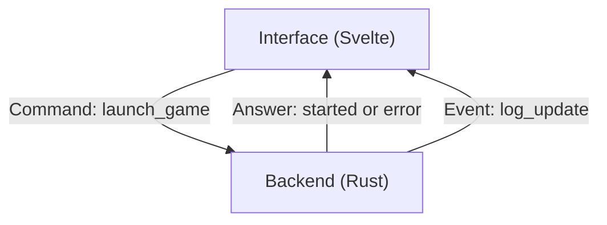
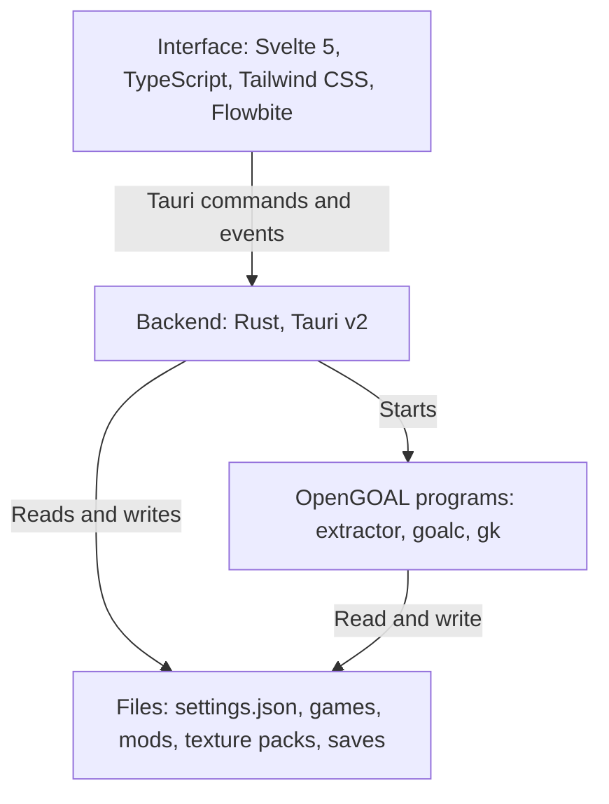

# Project Technologies

This page explains which technologies the launcher is built with, what each one does, and how they work together. It is written for someone who has never worked on a desktop application.

## Contents

- [1. The big picture](#1-the-big-picture)
- [2. Why Tauri](#2-why-tauri)
- [3. The technologies one by one](#3-the-technologies-one-by-one)
- [4. How the interface talks to the backend](#4-how-the-interface-talks-to-the-backend)
- [5. The OpenGOAL programs](#5-the-opengoal-programs)
- [6. Architecture diagram](#6-architecture-diagram)

## 1. The big picture

The launcher is made of three parts, each with its own job:

| Part                  | Built with                                   | Its job                                                            | Code         |
| :-------------------- | :------------------------------------------- | :----------------------------------------------------------------- | :----------- |
| The interface         | Svelte 5, TypeScript, Tailwind CSS, Flowbite | Everything you see and click: game pages, mod lists, settings.     | `src/`       |
| The backend           | Rust, Tauri v2                               | Everything that touches your computer: files, downloads, programs. | `src-tauri/` |
| The OpenGOAL programs | C++ (from the OpenGOAL project)              | Extracting, compiling and running the games.                       | downloaded   |

## 2. Why Tauri

A desktop application needs a user interface and access to the computer. There are two common ways to build one:

- **A native application** (for example in C++ or C#) is fast and light, but building a modern interface with it takes a lot of work.
- **An Electron application** uses web technologies (HTML, CSS, JavaScript), which makes the interface quick to build, but it ships a full copy of the Chrome browser, so it is large and uses a lot of memory.

[Tauri](https://tauri.app/) takes a middle path. The interface is a web page, displayed by the web engine already installed on the system (WebView2 on Windows, WebKit on Linux and macOS), so no browser is shipped. Everything else runs in Rust. The result is a small application with a web interface.

## 3. The technologies one by one

### Rust and Tauri v2: the backend

Rust is a programming language that produces fast programs and prevents many memory bugs when the code compiles. Tauri is the framework that turns a Rust program and a web page into one desktop application.

A web page cannot read your disk or start programs: browsers forbid it for safety. The Rust backend can, so it does all of that work for the interface. In the launcher it:

- reads and writes the settings file, `settings.json`;
- downloads OpenGOAL releases, mods and texture packs from GitHub;
- extracts archives and copies textures and saves;
- starts the game (`gk`) with the right command-line options, and tracks play time.

### Svelte 5 and TypeScript: the interface

Svelte is a framework for building interfaces from components, small reusable pieces such as a button or a game page. It converts the components into plain JavaScript when the application is built, so little work is left for the running application. Svelte 5 marks reactive data with "runes" (`$state`, `$derived`, `$props`, `$effect`): when the data changes, the screen updates by itself.

TypeScript is JavaScript with types. It checks, before the code runs, that each value is of the expected kind, for example that a number is never used where text is expected.

### Tailwind CSS v4 and Flowbite Svelte: the styling

Tailwind CSS styles elements with short class names written directly in the markup, such as `flex`, `gap-4` or `rounded-full`, instead of separate style sheets. Flowbite Svelte provides ready-made components built with Tailwind: dropdown menus, tooltips, toggles, progress bars.

### Vite: the build tool

Vite serves the interface during development and builds it for release. While you develop, it applies each saved change to the running launcher straight away, without a restart (hot module replacement). For a release, it bundles and minifies the interface files.

## 4. How the interface talks to the backend

The interface and the backend run separately. Tauri gives them two ways to communicate.

**Commands: the interface asks, the backend answers.** When you click **Play**, the interface calls `launchGame()` in [binaries.ts](../src/lib/rpc/binaries.ts). That function invokes the Rust command `launch_game`, which starts `gk` and answers straight away, or answers with an error the interface can show. In the background, the backend then waits for the game to close and records the play time.

**Events: the backend sends news without being asked.** While the OpenGOAL tools run, the backend sends each new line of their output as a `log_update` event. The log viewer ([LogViewer.svelte](../src/components/job/LogViewer.svelte)) listens for that event and shows the lines as they arrive.

## 5. The OpenGOAL programs

The launcher does not contain the games. It drives three programs from the [OpenGOAL](https://github.com/open-goal/jak-project) project, downloaded from that project's releases:

| Program     | What it does                                                                                                                       |
| :---------- | :--------------------------------------------------------------------------------------------------------------------------------- |
| `extractor` | Reads the PlayStation 2 disc image (ISO) of a game you own and extracts its models, textures, levels, sounds and code.             |
| `goalc`     | The compiler. Naughty Dog wrote the games in its own language, GOAL. `goalc` compiles that code into data the PC version can load. |
| `gk`        | The game itself, the "game kernel": it opens the window, plays the sound, reads the controller and saves, and draws the game.      |

## 6. Architecture diagram

